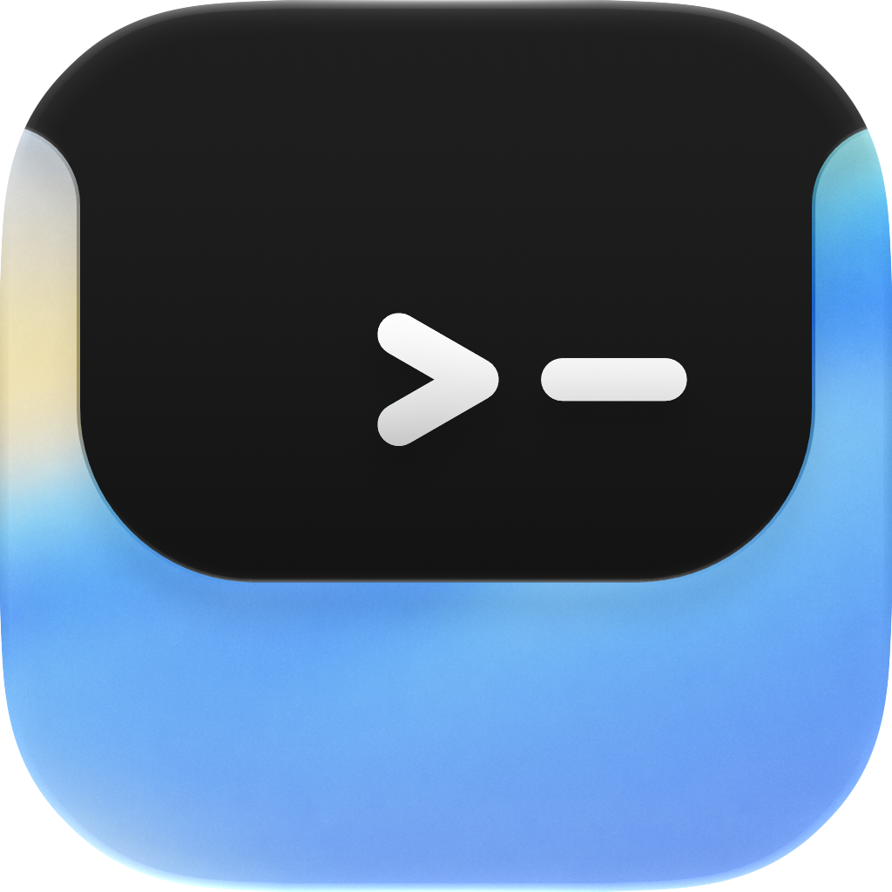
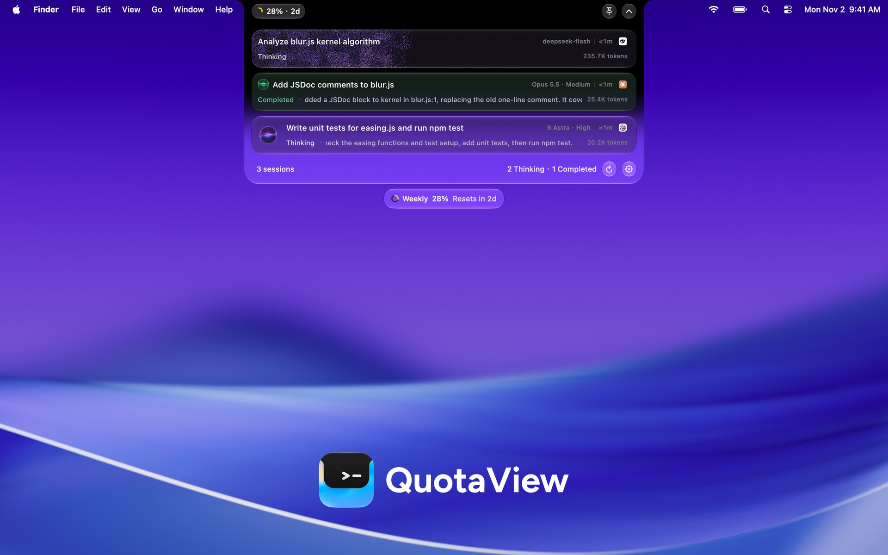
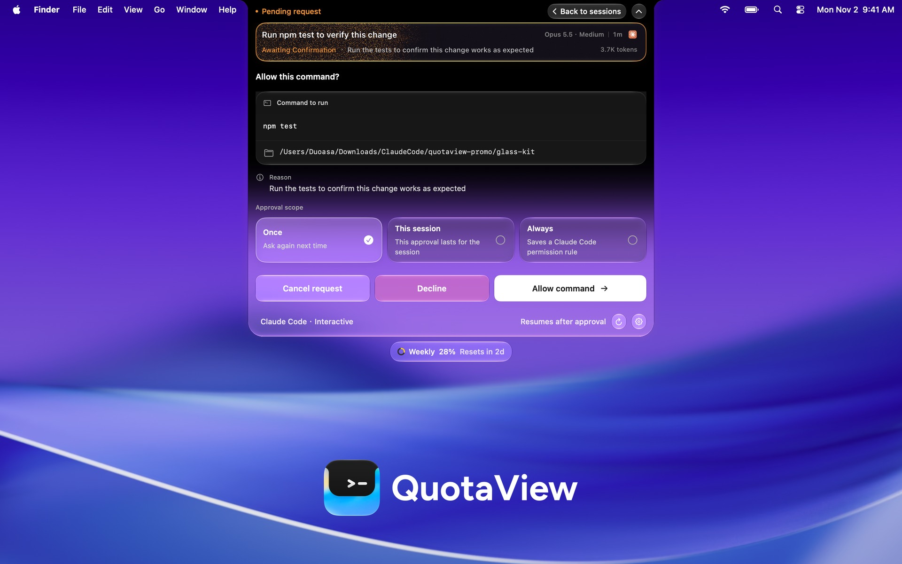
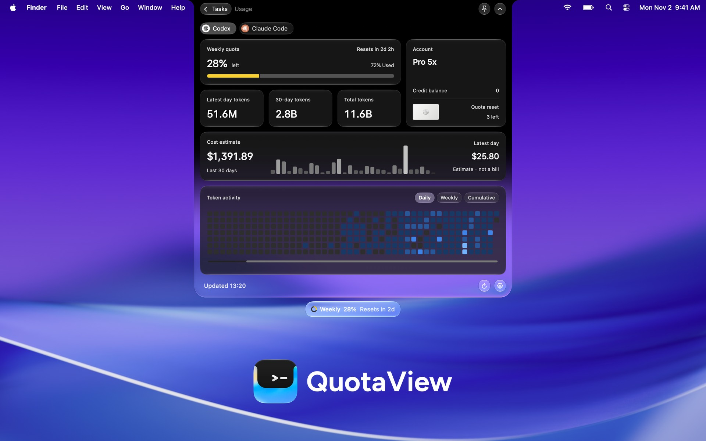
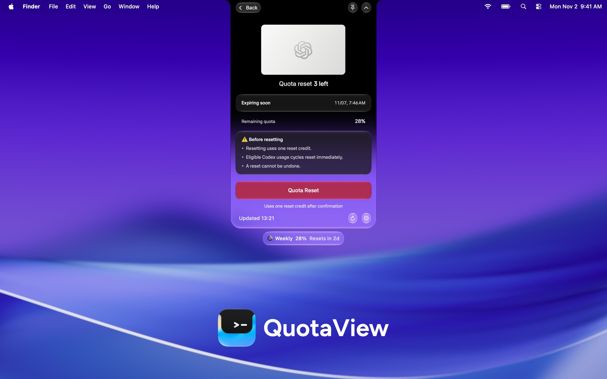
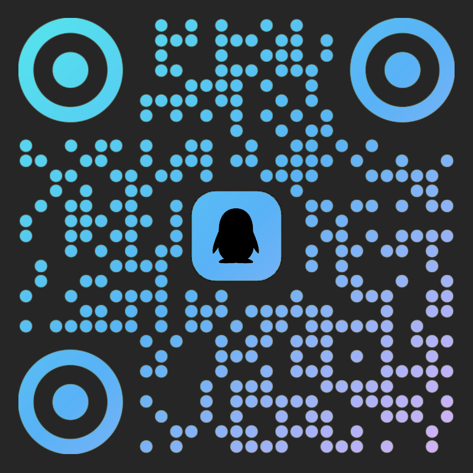

<p align="center"></p>

<h1 align="center">QuotaView</h1>

<p align="center"><strong>Dynamic Island for AI agents.</strong></p>

<p align="center">Tasks, approvals, and usage, together at the top of your desktop.</p>

<p align="center">
  <a href="https://github.com/Duoasa/QuotaView/releases/tag/v0.9.1-build.16"></a>
  <a href="https://github.com/Duoasa/QuotaView/releases/tag/v0.8.3-win.13"></a>
  <a href="https://github.com/Duoasa/QuotaView/actions/workflows/ci.yml"></a>
  <a href="LICENSE"></a>
</p>

<p align="center">
  <a href="https://github.com/Duoasa/QuotaView/releases/download/v0.9.1-build.16/QuotaView-v0.9.1-build.16.zip"><strong>Download for macOS</strong></a>
  · <a href="https://github.com/Duoasa/QuotaView/releases/download/v0.8.3-win.13/QuotaView-Windows-0.8.3-win.13-x64.zip"><strong>Download for Windows</strong></a>
  · <a href="#get-started">Get started</a>
  · <a href="#agent-support">Agent support</a>
</p>

<p align="center"><strong>English</strong> · <a href="README.zh-CN.md">简体中文</a></p>

[](docs/media/readme/0.9.1/en/cover.jpg)

QuotaView 0.9.1 introduces a refreshed visual identity: a blue terminal icon, updated agent marks, and a clearer desktop Island. The same QuotaView brings your agents' work and usage into one place.

## Keep track of the work

The compact Island shows the current state beside a floating usage capsule. Keep your attention on the work while tasks stay visible above it.

[](docs/media/readme/0.9.1/en/01-compact.jpg)

Expand the Island to follow multiple agents, task models, Token counts, and available parent/subagent activity. Review public progress and result details when the original client provides them; missing information keeps its placeholder.

[](docs/media/readme/0.9.1/en/02-expanded.jpg)

## Read the request before approving

Review commands, working directories, reasons, and permission scopes before allowing or declining a request. Supported Codex and Claude Code requests can be handled in the Island. Other integrations show reminders and leave approval to the original client.

[](docs/media/readme/0.9.1/en/03-approval.jpg)

## Quota, Tokens, and activity in one place

Switch between Codex and Claude Code to see available quota windows, reset times, Token history, estimated cost, and activity heatmaps. The floating capsule shows a five-hour window, a weekly window, or both, depending on the account.

[](docs/media/readme/0.9.1/en/04-usage.jpg)

Available fields depend on the client and collection settings. Missing values remain unknown. Costs are estimates, not bills.

## Check before you reset

**Codex:** review available reset credits and the list expiring within a week. A protection setting can disable credit use. Using a credit requires explicit confirmation and consumes one real reset opportunity; a manual retry reuses the saved operation to avoid duplicate submissions.

[](docs/media/readme/0.9.1/en/05-reset.jpg)

**Claude Code:** copy `/limit-reset`, then run it in Claude Code to view remaining resets and deadlines. QuotaView does not perform Claude resets on your behalf.

## Make it fit your desktop

Choose Liquid Glass or a classic solid appearance, then select State Smoke, Quantum Noise, or Liquid Wave from the live preview. Adjust width, capsule visibility, privacy mode, and automatic expansion. On multiple displays, follow the active window or choose a fixed screen.

Native Liquid Glass requires macOS 26 or later. macOS 14–15 uses translucent materials; classic solid mode is also available. Product images show macOS. The [earlier 0.8.5 video walkthrough](https://duoasa.github.io/QuotaView/demos/0.8.5/en/) remains available.

## Agent support

| Agent | Tasks and confirmations | Usage |
| --- | --- | --- |
| **Codex** | Automatic local discovery, optional activity Hook, and supported in-Island confirmations. | Available account quota, reset times, Credits, Tokens, estimated cost, and manual quota resets. |
| **Claude Code** | Opt-in Hooks for task status and supported permission requests. | Local Token history and estimated cost; official quota windows with status-line collection enabled. |
| **DSH** | Native plugin for sessions, tools, compaction, and permission reminders. | Task Tokens when supplied by events; no account quota dashboard. |
| **Kimi Code** | Hooks for task status, tools, compaction, and permission reminders. | No account quota or historical cost dashboard. |
| **Cursor / Gemini CLI / OpenCode / GitHub Copilot CLI — preview** | Optional local task status integrations; confirmations stay in the original client. | Available event metadata; no account quota dashboard. |
| **Devin Desktop — preview** | Separate integration switch and task identity. | Current session model and current-turn Tokens when supported local records are available. |
| **Devin CLI — preview** | Separate integration switch and task identity. | Current session model and current-turn Tokens when supported local records are available. |

Fields depend on the client version and configuration. Preview integrations are still being tested across client environments; missing data remains unknown. See the [integration contract](docs/specs/agent-integrations.md). This table describes macOS; Windows has its own supported feature set.

## Get started

| Platform | Current release | Requirements and guide |
| --- | --- | --- |
| **macOS** | [0.9.1 Build 16](https://github.com/Duoasa/QuotaView/releases/download/v0.9.1-build.16/QuotaView-v0.9.1-build.16.zip) | macOS 14+; Universal Apple silicon + Intel; Developer ID signed and Apple notarized. |
| **Windows** | [0.8.3-win.13](https://github.com/Duoasa/QuotaView/releases/download/v0.8.3-win.13/QuotaView-Windows-0.8.3-win.13-x64.zip) | x64; [installation and connection guide](Windows/README.md). |

1. Download, unzip, and open `QuotaView.app` on macOS.
2. Open **Settings → Connections** and enable the agents you use. Install and configure the agent clients separately.
3. Codex tasks are discovered locally. After configuring Hooks or a plugin, start a new session or restart the relevant client as indicated.

macOS automatic update checks are **on by default**. Your existing preference is respected, you can turn checks off in Settings, and downloading/installing updates requires confirmation.

Windows is a reduced-feature adaptation with a solid-color Island, AI orb and quantum-noise effects, tasks, supported approvals, and usage statistics. Desktop widgets and native Liquid Glass are not included. Both platforms use separate update channels; this macOS release does not change the Windows version.

### New in 0.9.1

- A refreshed brand identity, app and agent icons, neutral completed cards, and flowing completion highlights.
- Clearer settings, improved previews, and Japanese, Korean, Traditional Chinese, and Spanish support.
- Preview agent integrations, including separate Devin Desktop and Devin CLI entries with model and Token reading.
- Reset credit protection and a list of credits expiring within a week.
- Less repeated background reading, background Claude transcript parsing, and on-demand effect loading.

[Release notes](https://github.com/Duoasa/QuotaView/releases/tag/v0.9.1-build.16) · [Version history](VERSION_HISTORY.md)

## Privacy by design

Task information is processed locally. QuotaView does not send task content to a QuotaView service or collect login credentials. Connections use local APIs, bounded session records, Hooks, or native plugins.

Enabling an integration may modify the client's configuration. QuotaView backs it up first and manages only its own entries. Codex resets save a local operation record for safe retries, without login credentials. Do not include credentials or raw session records in bug reports.

## Build from source

```bash
git clone https://github.com/Duoasa/QuotaView.git
cd QuotaView
swift test
swift run QuotaView
```

Use Swift 6 or a compatible Xcode toolchain, plus Node.js for DSH plugin tests. For the full app and widget, open `QuotaView.xcodeproj`, select **QuotaView** and **My Mac**, then run. Windows build instructions are in [Windows/README.md](Windows/README.md).

See the [release workflow](docs/workflow/RELEASE.md) for distribution signing, notarization, and update-key requirements.

## Project and feedback

- [Report an issue](https://github.com/Duoasa/QuotaView/issues/new/choose), or use **Settings → Bug Feedback**.
- [Contributing](CONTRIBUTING.md) · [Design and behavior specifications](docs/specs/README.md) · [Development handoff](HANDOFF.md)
- Open source under the [MIT license](LICENSE).

**QQ feedback group: 1108649282**

<p align="center"></p>
