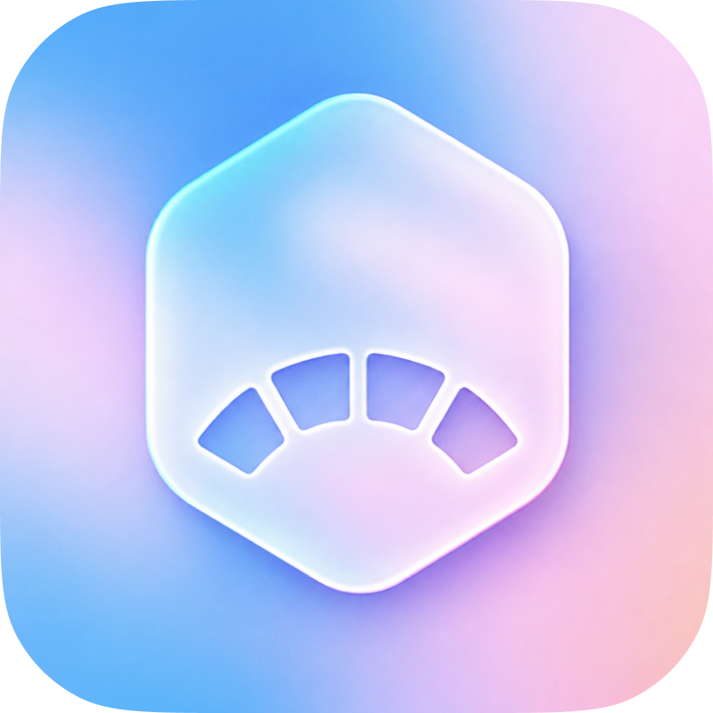
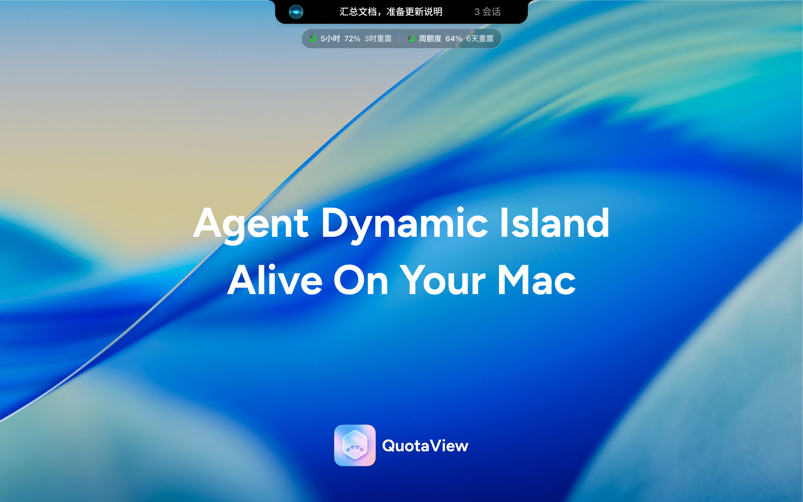
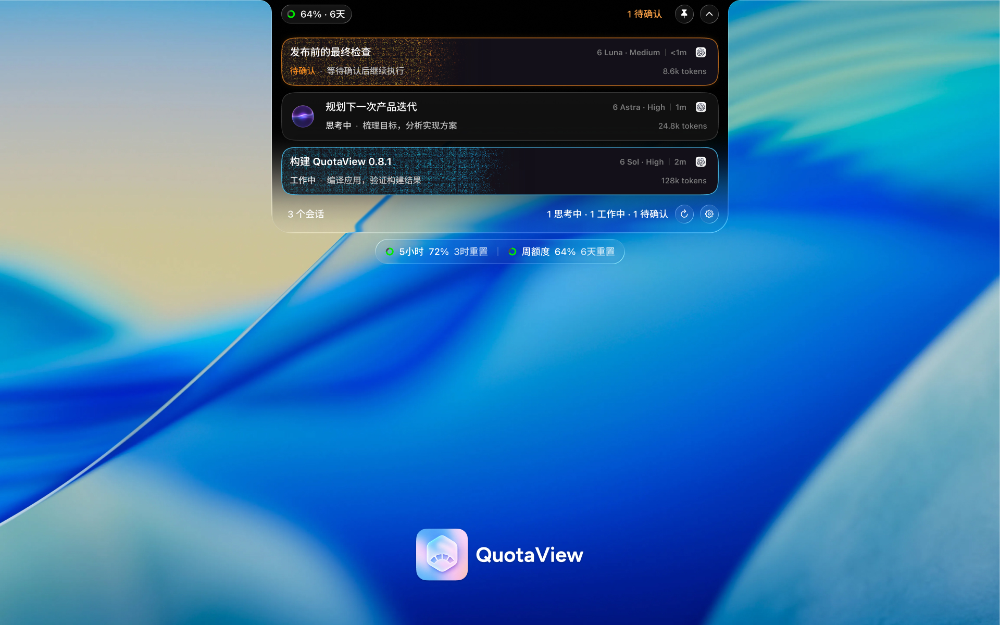
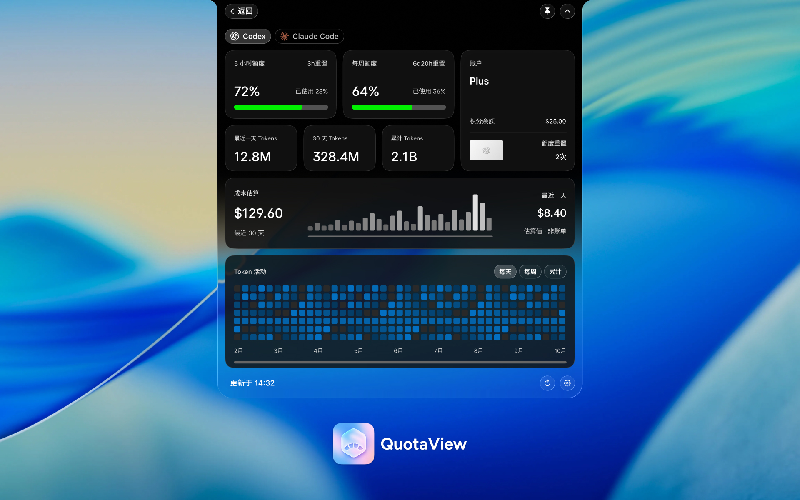
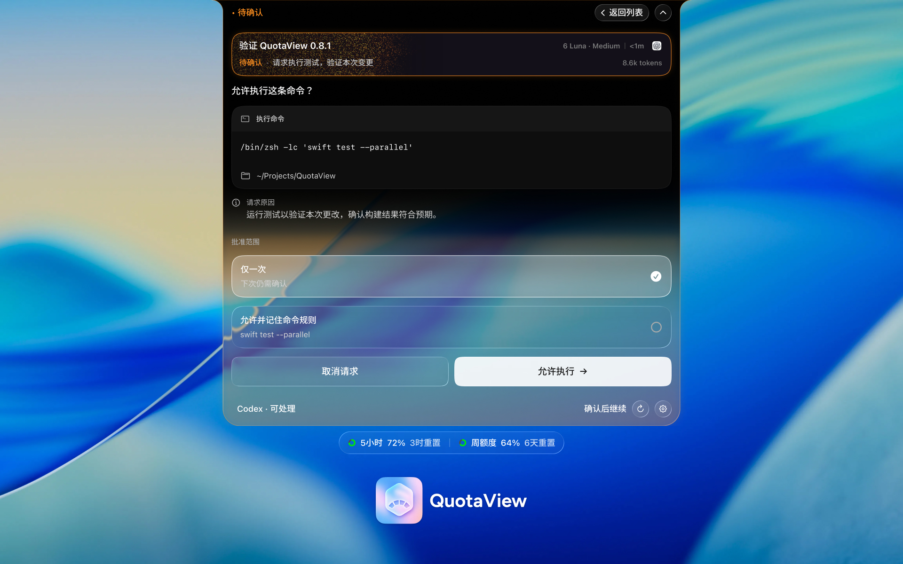
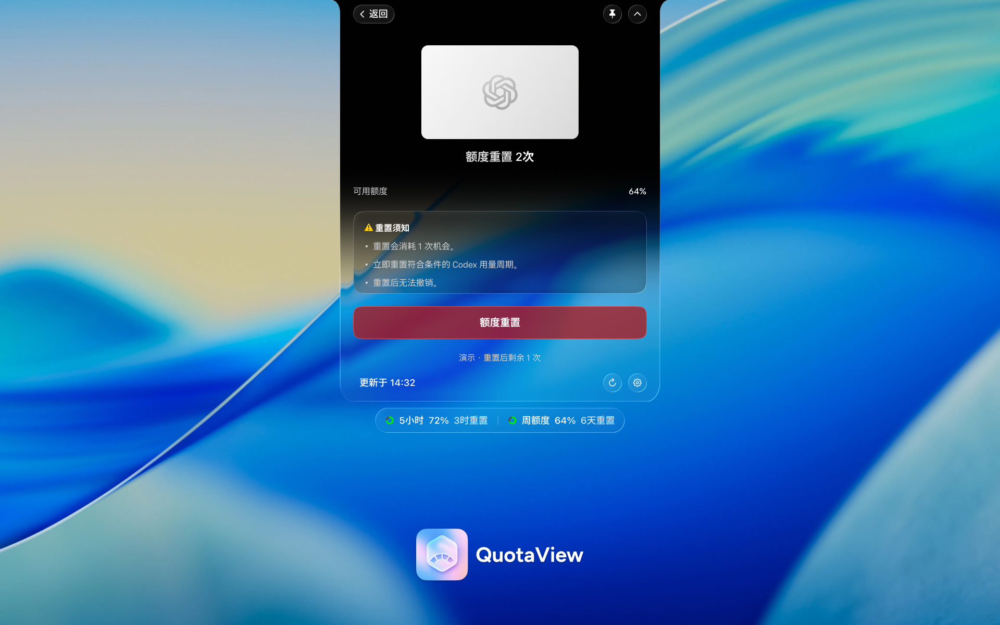
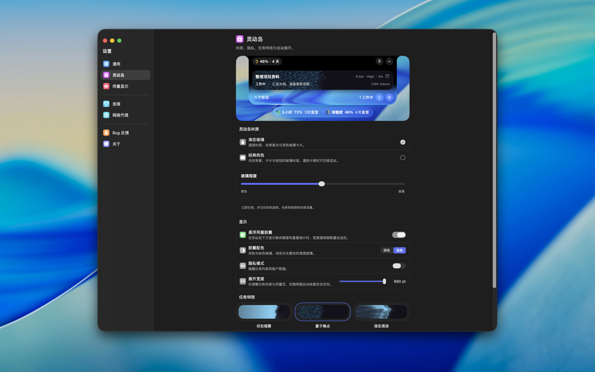
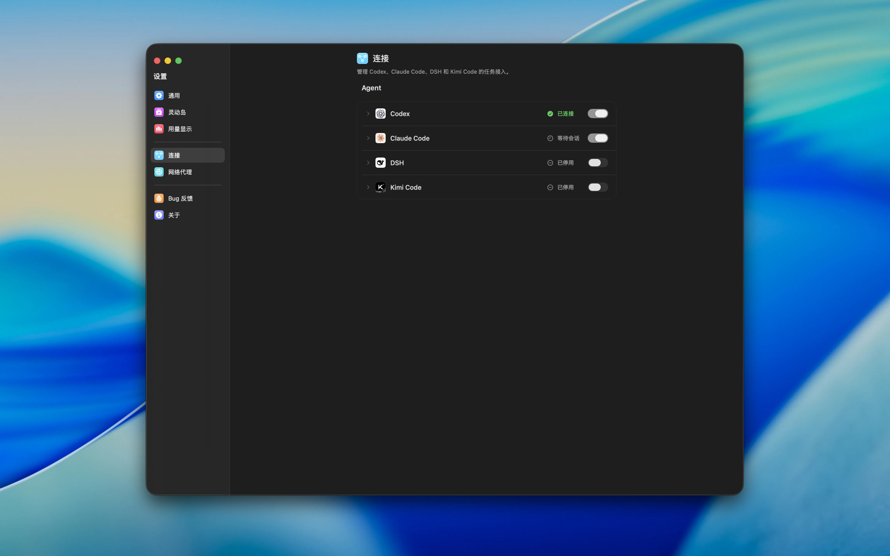
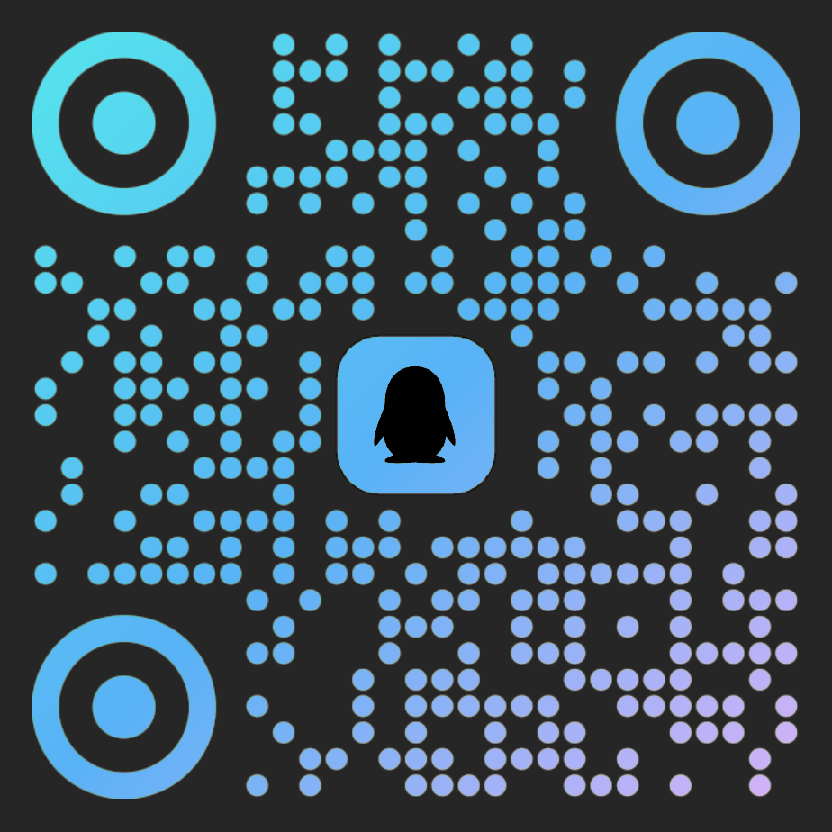

<p align="center">
  
</p>

<h1 align="center">QuotaView · Agent Island for macOS</h1>

<p align="center">
  Liquid Glass is back.
</p>

<p align="center">
  Live status, progress, approvals, turn tokens, completion receipts, and quota—inside one native Island.
</p>

<p align="center">
  <a href="https://github.com/Duoasa/QuotaView/releases/tag/v0.8.3-build.1"></a>
  <a href="https://github.com/Duoasa/QuotaView/actions/workflows/ci.yml"></a>
  
  
  <a href="LICENSE"></a>
</p>

<p align="center">
  <a href="https://github.com/Duoasa/QuotaView/releases/download/v0.8.3-build.1/QuotaView-v0.8.3-build.1.zip"><strong>Download QuotaView v0.8.3 Build 1</strong></a>
  ·
  <a href="#get-started">Get started</a>
  ·
  <a href="#privacy-by-design">Privacy</a>
  ·
  <a href="#build-from-source">Build from source</a>
</p>

<p align="center">
  <strong>English</strong> · <a href="README.zh-CN.md">简体中文</a>
</p>

## What’s new in 0.8.3

Improved Liquid Glass compatibility on macOS 27, with Light, Dark, and Auto appearance choices for the Island’s lower glass area and floating usage capsule. Both now share the same clear material. Island settings are grouped more clearly, with refined toolbar icons and label spacing.

This release also fixes a custom-font decoding issue that could leave desktop widgets blank after a system upgrade. The bundled Asta Sans typography is preserved.

## Also included from 0.8.2

A small update for multi-display setups. In General settings, let the Island follow the active window or choose a fixed display. Your selection is remembered; if that display disconnects, the Island returns to the main display until it reconnects. Sub-agent activity is now centered in the lower part of its task card.

## Liquid Glass is back

QuotaView 0.8.1 brings a new Liquid Glass interface to the Island. Tasks, usage, and approvals stay at the top of your screen, with surfaces that pick up the light and color of your desktop.



### A clear view of every task

Thinking, working, awaiting confirmation, and completed tasks have distinct orbs and effects. Expand the Island to see concurrent tasks, subagents, models, and Token counts, then read the result when a task finishes. Cards share consistent corners, spacing, and alignment, with smoother expansion and page transitions.



### Usage at a glance

The new floating usage capsule shows remaining quota and reset times. Accounts with a five-hour window see it alongside the weekly window; accounts with only a weekly window get a narrower capsule. Its glass appearance follows the Island’s Light, Dark, or Auto choice; a separate switch controls visibility.

Switch between Codex and Claude Code in the usage page to see available quota, Token history, estimated cost, and activity. Costs are estimates, not bills. Available data varies by client.



### Read the request before you approve

A warm amber glow draws attention to requests that need confirmation. Commands, working directories, reasons, and permission scope have their own sections, with a light glass primary button. Supported requests can be handled in the Island; others point you back to the original client.

This release fixes a Codex confirmation connection issue that could stop later approval details from updating after resubscription.



### A redesigned reset card

Reset credits, available quota, and instructions share one page, with a more visible red action button. **Quota reset remains a demonstration and does not consume real reset credits.**



### Make it fit your desktop

Settings now uses a sidebar layout with a smaller window and more compact text, icons, and controls. Choose Liquid Glass or a classic solid appearance, adjust the black area from 20% to 80%, and set the expanded width, capsule visibility, privacy, and automatic expansion. Light, Dark, and Auto appearance previews are available only with Liquid Glass.

The preview follows your material choice and shows both quota windows. Pick from State Smoke, Quantum Noise, and Liquid Wave task effects.



### Connect the agents you use

Manage Codex, Claude Code, DSH, and Kimi Code in one place, with connection status, switches, and each integration’s details together.



Product images show the 0.8.1 interface with sample data; settings have since been reorganized. Actual quota, task states, and available actions depend on your local clients. Native Liquid Glass requires macOS 26; earlier systems use translucent materials, with classic solid mode also available.

## Agent support

| Agent | Tasks and confirmations | Usage |
| --- | --- | --- |
| **Codex** | Automatic local task discovery, optional activity Hook, and supported in-Island confirmations. | Available account quota, reset times, Credits, Tokens, and estimated cost. |
| **Claude Code** | Opt-in Hooks for task status and supported permission requests. | Local Token history and estimated cost; official quota windows when status-line collection is enabled. |
| **DSH** | Native session plugin for lifecycle, tools, compaction, and permission reminders. Compatible custom clients appear under DSH. | Task Token counts when supplied by events; no account quota or historical cost dashboard. |
| **Kimi Code** | Hooks for lifecycle, tools, compaction, and permission reminders. | No account quota or historical cost dashboard. |

DSH and Kimi Code permissions are confirmed in the original client. Available fields depend on the agent and version; unavailable values keep their placeholders. DSH and Kimi integrations are opt-in. See the [integration contract](docs/specs/agent-integrations.md) for compatibility boundaries.

## Get started

1. Download [QuotaView 0.8.3 Build 1](https://github.com/Duoasa/QuotaView/releases/tag/v0.8.3-build.1), unzip it, and open `QuotaView.app`.
2. Open **Settings → Connections** and enable the agents you use.
3. Codex tasks are discovered locally. After configuring Hooks or a DSH plugin, start a new session or restart the relevant client as indicated in settings.

The release is signed with Developer ID, notarized by Apple, and stapled.

Requires **macOS 14 or later**. The Universal app supports Apple silicon and Intel Macs. Agent clients must be installed and configured separately.

Updates use the Stable channel. Automatic checks are optional; installing an update requires confirmation.

## Privacy by design

Task information is processed locally. QuotaView does not send task content to a QuotaView service or collect login credentials. Connections use local APIs, bounded session records, Hooks, or native plugins.

Enabling an integration may modify the client's configuration. QuotaView backs up the configuration and manages only its own marked entries. DSH custom clients keep their own data directories and identities.

Cost values are estimates, not bills. The quota-reset view remains a local demonstration and does not consume real reset credits. Do not include credentials or raw session records in bug reports.

## Build from source

```bash
git clone https://github.com/Duoasa/QuotaView.git
cd QuotaView
swift test
swift run QuotaView
```

Use Swift 6 or a compatible Xcode toolchain, plus Node.js for the DSH plugin tests. For the full app and widget, open `QuotaView.xcodeproj`, select **QuotaView** and **My Mac**, then run.

Distribution packaging uses `scripts/build-app.sh`. Developer ID signing and notarization require your own signing identity, notary profile, and a recoverable encrypted backup of the Sparkle update key. See the [release workflow](docs/workflow/RELEASE.md).

## Project and feedback

- [Current release](https://github.com/Duoasa/QuotaView/releases/tag/v0.8.3-build.1) · [Previous stable 0.8.2](https://github.com/Duoasa/QuotaView/releases/tag/v0.8.2-build.2)
- [Version history and release evidence](VERSION_HISTORY.md) · [Development handoff](HANDOFF.md)
- [Design and behavior specifications](docs/specs/README.md) · [Contributing](CONTRIBUTING.md)
- [Report an issue](https://github.com/Duoasa/QuotaView/issues/new/choose), or use **Settings → Bug Feedback**.

Open source under the [MIT license](LICENSE).

**QQ feedback group: 1108649282**

<p align="center">
  
</p>
