<h1 align="center">QuotaView</h1>

<p align="center"><strong>Your tasks, approvals, and usage. At the top of your desktop.</strong></p>

<p align="center">Keep an eye on Codex, Claude Code, DSH, and Kimi Code from one desktop Island.</p>

<p align="center">
  <a href="https://github.com/Duoasa/QuotaView/releases/tag/v0.8.6-build.21"></a>
  <a href="https://github.com/Duoasa/QuotaView/releases/tag/v0.8.3-win.10"></a>
  <a href="https://github.com/Duoasa/QuotaView/actions/workflows/ci.yml"></a>
  <a href="LICENSE"></a>
</p>

<p align="center">
  <a href="https://github.com/Duoasa/QuotaView/releases/download/v0.8.6-build.21/QuotaView-v0.8.6-build.21.zip"><strong>Download for macOS</strong></a>
  · <a href="https://github.com/Duoasa/QuotaView/releases/download/v0.8.3-win.10/QuotaView-Windows-0.8.3-win.10-x64.zip"><strong>Download for Windows</strong></a>
  · <a href="#get-started">Get started</a>
  · <a href="#agent-support">Agent support</a>
</p>

<p align="center"><strong>English</strong> · <a href="README.zh-CN.md">简体中文</a></p>

## See it in action

A 68-second walkthrough of the compact Island, tasks, approvals, usage, and settings. Select the cover to play the English demo in your browser.

[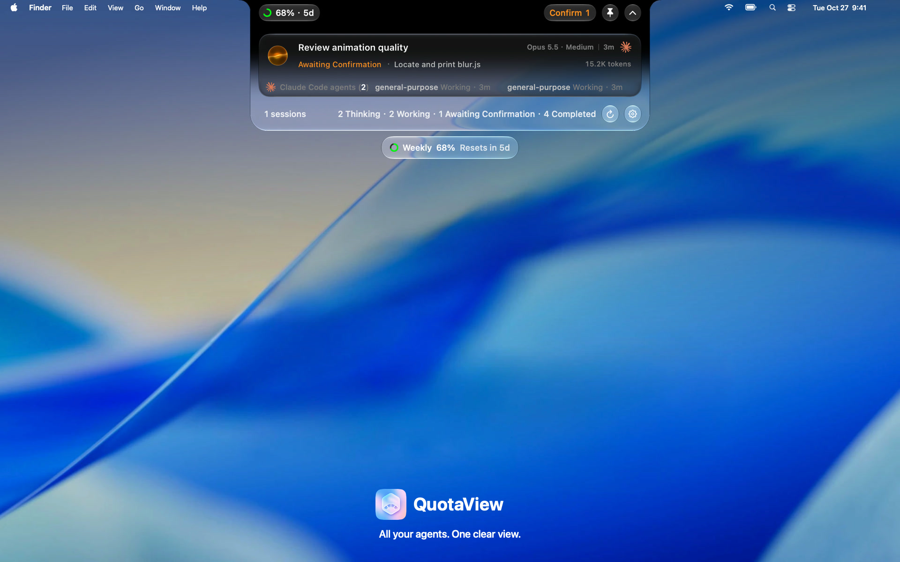](https://duoasa.github.io/QuotaView/demos/0.8.5/en/)

**[▶ English demo · 1:08](https://duoasa.github.io/QuotaView/demos/0.8.5/en/)** · [MP4 file](https://duoasa.github.io/QuotaView/demos/0.8.5/en/QuotaView-demo-en.mp4)

These images and videos show the macOS app. The interface was captured on a real Mac; the menu bar, branding, and captions were composited. Original task text and unavailable-transcript messages are preserved. No reset credits were used in the demo. Select a product image to view it at full size.

## Keep track of the work

The compact Island shows the current state beside a floating usage capsule. Expand it to see tasks, models, Token counts, and parent/subagent activity. Thinking, working, awaiting confirmation, and completed tasks have distinct indicators.

<table>
  <tr>
    <th width="50%">Compact Island and usage capsule</th>
    <th width="50%">Parent tasks and subagents</th>
  </tr>
  <tr>
    <td><a href="docs/media/readme/en/00-compact.jpg">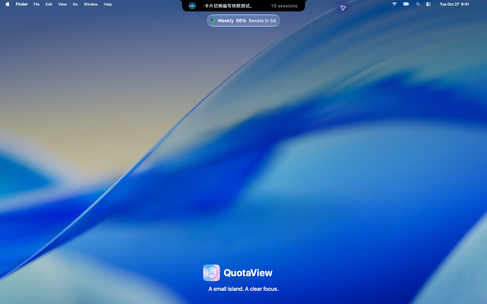</a></td>
    <td><a href="docs/media/readme/en/12-subagents.jpg">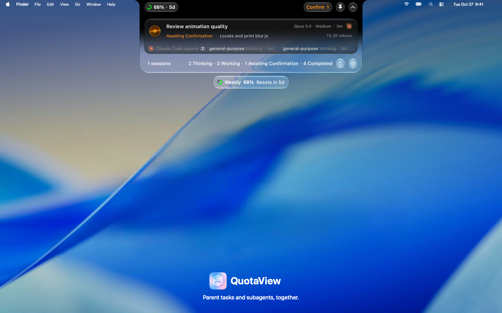</a></td>
  </tr>
</table>

### Follow a task through to completion

Open a task to inspect available progress, then review its completion state and result details. Information comes from the original client; unavailable progress or transcripts remain clearly marked.

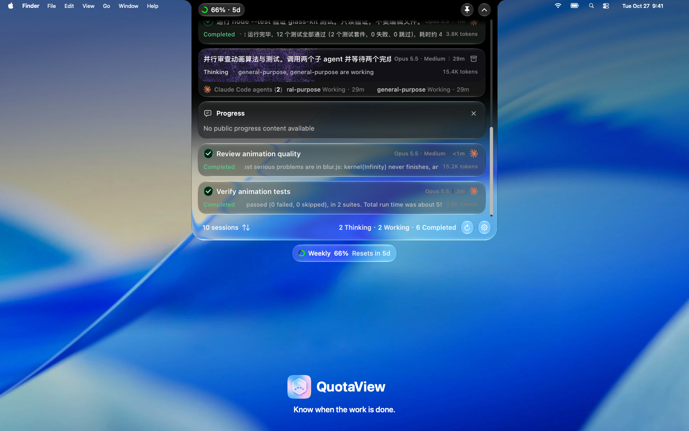

### Read the request before approving

Review the command, working directory, reason, and permission scope before allowing or declining a request. Supported Codex and Claude Code requests can be handled in the Island. DSH and Kimi Code permissions are confirmed in the original client.

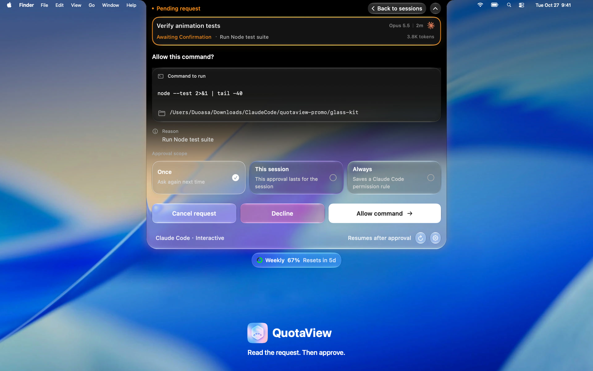

## Quota, Tokens, and activity in one place

Switch between Codex and Claude Code to see their available quota windows, reset times, Token history, estimated cost, and activity heatmap. The floating capsule shows a five-hour window, a weekly window, or both, depending on the account.

<table>
  <tr>
    <th width="50%">Codex usage</th>
    <th width="50%">Claude Code usage</th>
  </tr>
  <tr>
    <td><a href="docs/media/readme/en/04-usage-codex.jpg">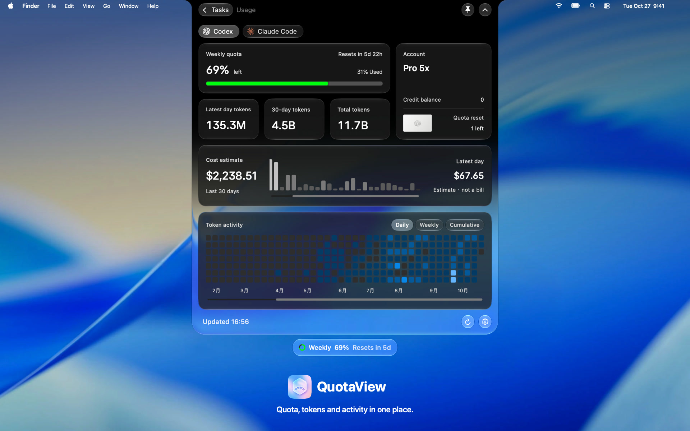</a></td>
    <td><a href="docs/media/readme/en/05-usage-claude.jpg">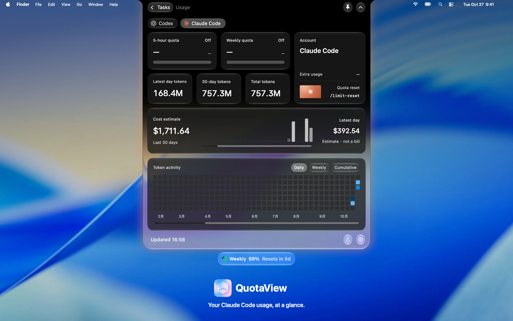</a></td>
  </tr>
</table>

Available quota fields depend on the client and collection settings. Missing values keep their placeholders. Costs are estimates, not bills.

### Check before you reset

**Codex:** check the available credit, then explicitly confirm its use. Confirmation consumes one real reset credit. If a request is interrupted, a manual retry reuses the same operation and credit to avoid duplicate submissions.

**Claude Code:** copy `/limit-reset`, then run it in Claude Code to view remaining resets and deadlines. QuotaView does not perform Claude resets on your behalf.

<table>
  <tr>
    <th width="50%">Manual Codex reset</th>
    <th width="50%">Native Claude Code command</th>
  </tr>
  <tr>
    <td><a href="docs/media/readme/en/07-reset-codex.jpg">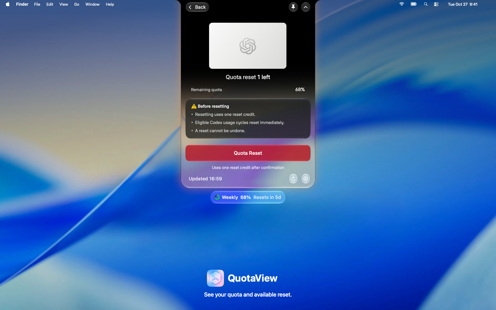</a></td>
    <td><a href="docs/media/readme/en/06-reset-claude.jpg">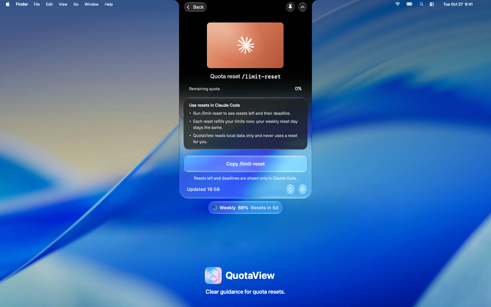</a></td>
  </tr>
</table>

## Make it fit your desktop

Choose Liquid Glass or a classic solid appearance. With Liquid Glass, Light, Dark, and Auto apply consistently to the lower glass area, buttons, and usage capsule. Task-effect choices sit directly below their preview: choose State Smoke, Quantum Noise, or Liquid Wave.

Adjust expanded width, capsule visibility, privacy mode, and automatic expansion. On multiple displays, follow the active window or select a fixed screen. Manage each agent from the Connections page.

<table>
  <tr>
    <th width="50%">Appearance and task effects</th>
    <th width="50%">Agent connections</th>
  </tr>
  <tr>
    <td><a href="docs/media/readme/en/08-settings-island.jpg">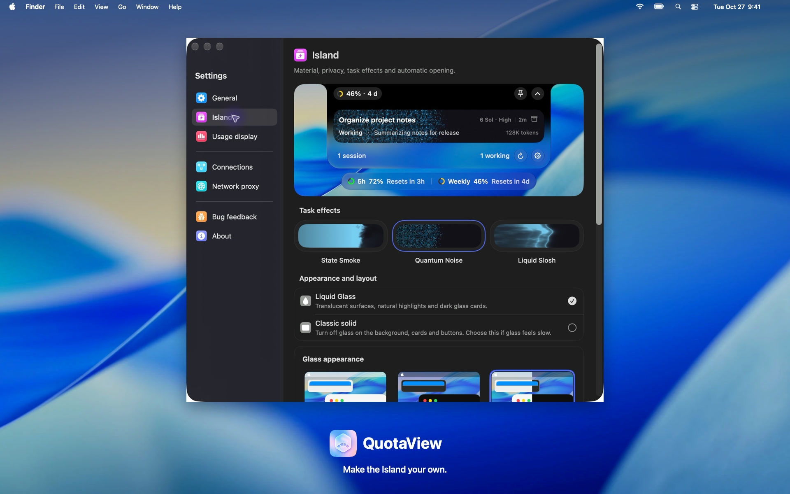</a></td>
    <td><a href="docs/media/readme/en/09-settings-connections.jpg">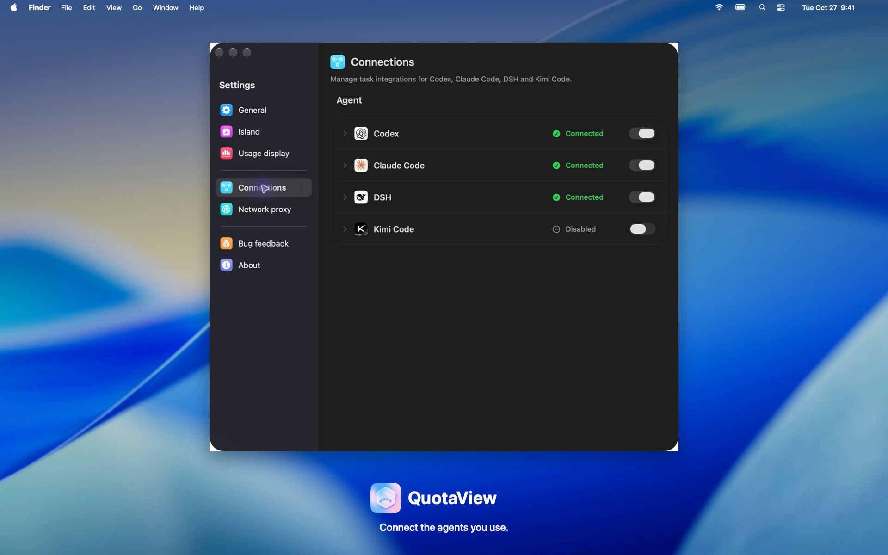</a></td>
  </tr>
</table>

Native Liquid Glass requires macOS 26 or later. macOS 14–15 uses translucent materials; classic solid mode is also available.

## Agent support

| Agent | Tasks and confirmations | Usage |
| --- | --- | --- |
| **Codex** | Automatic local task discovery, optional activity Hook, and supported in-Island confirmations. | Available account quota, reset times, Credits, Tokens, estimated cost, and manual quota resets. |
| **Claude Code** | Opt-in Hooks for task status and supported permission requests. | Local Token history and estimated cost; official quota windows when status-line collection is enabled. |
| **DSH** | Native plugin for sessions, tools, compaction, and permission reminders. Compatible custom clients appear under DSH. | Task Token counts when supplied by events; no account quota or historical cost dashboard. |
| **Kimi Code** | Hooks for task status, tools, compaction, and permission reminders. | No account quota or historical cost dashboard. |

Available fields and actions depend on the agent and its version. DSH and Kimi integrations are opt-in. See the [integration contract](docs/specs/agent-integrations.md) for details. This table describes macOS; see the Windows guide for its supported features.

## Get started

| Platform | Current release | Requirements and guide |
| --- | --- | --- |
| **macOS** | [0.8.6 Build 21](https://github.com/Duoasa/QuotaView/releases/download/v0.8.6-build.21/QuotaView-v0.8.6-build.21.zip) | macOS 14+; Universal Apple silicon + Intel; Developer ID signed and Apple notarized. |
| **Windows** | [0.8.3-win](https://github.com/Duoasa/QuotaView/releases/download/v0.8.3-win.10/QuotaView-Windows-0.8.3-win.10-x64.zip) | x64; [installation and connection guide](Windows/README.md). |

**On macOS:**

1. Download, unzip, and open `QuotaView.app`.
2. Open **Settings → Connections** and enable the agents you use. Agent clients must be installed and configured separately.
3. Codex tasks are discovered locally. After configuring Hooks or a DSH plugin, start a new session or restart the relevant client as indicated.

The Windows edition is available as a reduced-feature adaptation of the macOS app, with further improvements planned. It includes a solid-color Island, AI orb and quantum-noise effects, tasks and supported approvals, and usage statistics. Desktop widgets and native Liquid Glass are not included. Both platforms are maintained in this repository with separate update channels. The Windows package version and tag retain `0.8.3-win.10`.

macOS updates use the Stable channel. Automatic checks are optional; installing an update requires confirmation.

### New in 0.8.5

- Manual Codex quota resets through the official interface, with explicit confirmation and a saved operation record for retries.
- Matching dark glass on the reset page, aligned quota text, and appearance-aware buttons and captions.
- Task-effect choices directly below the Settings preview, alongside the existing macOS 27 glass compatibility, widget fix, and display settings.

[Full release notes](https://github.com/Duoasa/QuotaView/releases/tag/v0.8.5-build.1) · [Version history](VERSION_HISTORY.md)

## Privacy by design

Task information is processed locally. QuotaView does not send task content to a QuotaView service or collect login credentials. Connections use local APIs, bounded session records, Hooks, or native plugins.

Enabling an integration may modify the client's configuration. QuotaView backs it up first and manages only its own marked entries. DSH custom clients retain their own data directories and session identities. Codex resets save a local operation record for safe retries, without saving login credentials. Do not include credentials or raw session records in bug reports.

## Build from source

```bash
git clone https://github.com/Duoasa/QuotaView.git
cd QuotaView
swift test
swift run QuotaView
```

Use Swift 6 or a compatible Xcode toolchain, plus Node.js for DSH plugin tests. For the full app and widget, open `QuotaView.xcodeproj`, select **QuotaView** and **My Mac**, then run. Windows build instructions are in [Windows/README.md](Windows/README.md).

See the [release workflow](docs/workflow/RELEASE.md) for distribution signing, notarization, and update-key requirements.

## Project and feedback

- [Report an issue](https://github.com/Duoasa/QuotaView/issues/new/choose), or use **Settings → Bug Feedback**.
- [Contributing](CONTRIBUTING.md) · [Design and behavior specifications](docs/specs/README.md) · [Development handoff](HANDOFF.md)
- Open source under the [MIT license](LICENSE).

**QQ feedback group: 1108649282**

<p align="center"></p>
