<h1 align="center">QuotaView</h1>

<p align="center"><strong>任务、审批与用量，都在桌面顶部。</strong></p>

<p align="center">在一个灵动岛里，关注 Codex、Claude Code、DSH 与 Kimi Code 的工作状态。</p>

<p align="center">
  <a href="https://github.com/Duoasa/QuotaView/releases/tag/v0.8.5-build.1"></a>
  <a href="https://github.com/Duoasa/QuotaView/releases/tag/v0.8.3-win.10"></a>
  <a href="https://github.com/Duoasa/QuotaView/actions/workflows/ci.yml"></a>
  <a href="LICENSE"></a>
</p>

<p align="center">
  <a href="https://github.com/Duoasa/QuotaView/releases/download/v0.8.5-build.1/QuotaView-v0.8.5-build.1.zip"><strong>下载 macOS 版</strong></a>
  · <a href="https://github.com/Duoasa/QuotaView/releases/download/v0.8.3-win.10/QuotaView-Windows-0.8.3-win.10-x64.zip"><strong>下载 Windows 版</strong></a>
  · <a href="#快速开始">快速开始</a>
  · <a href="#agent-支持范围">Agent 支持范围</a>
</p>

<p align="center"><a href="README.md">English</a> · <strong>简体中文</strong></p>

## 实机演示

从收起态与多任务列表，到审批、用量和设置，约 75 秒了解 QuotaView。点击封面，在浏览器中直接播放中文版演示。

[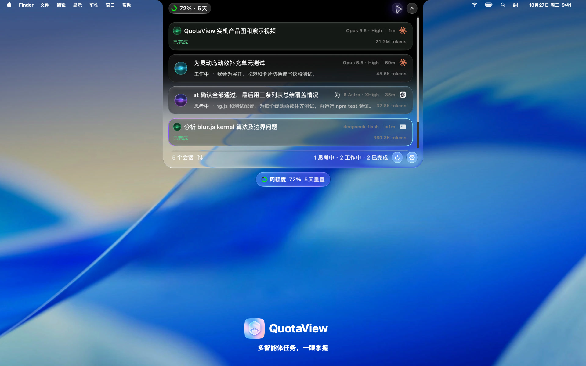](https://duoasa.github.io/QuotaView/demos/0.8.5/zh-CN/)

**[▶ 中文演示 · 1:15](https://duoasa.github.io/QuotaView/demos/0.8.5/zh-CN/)** · [MP4 原视频](https://duoasa.github.io/QuotaView/demos/0.8.5/zh-CN/QuotaView-demo-zh-CN.mp4)

下方配图与视频展示 macOS 版。界面来自实机采集，菜单栏、标识与字幕经过后期合成；任务原文保留原语言，未同步的结果按实机提示展示。演示没有使用重置卡。点击产品图可查看大图。

## 任务状态，抬眼就能看到

收起时，只留下当前状态和悬浮用量胶囊；展开后，查看任务列表、模型、Token 数，以及主任务与子 Agent 的关系。思考、工作、等待确认和完成状态有各自的提示。

<table>
  <tr>
    <th width="50%">收起态与用量胶囊</th>
    <th width="50%">主任务与子 Agent</th>
  </tr>
  <tr>
    <td><a href="docs/media/readme/zh-CN/00-compact.jpg">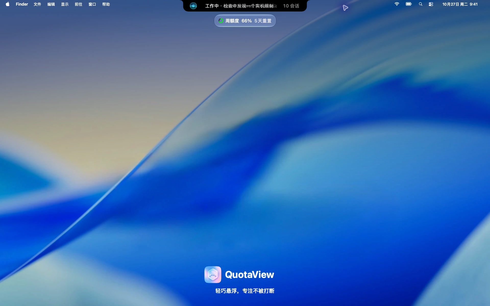</a></td>
    <td><a href="docs/media/readme/zh-CN/12-subagents.jpg">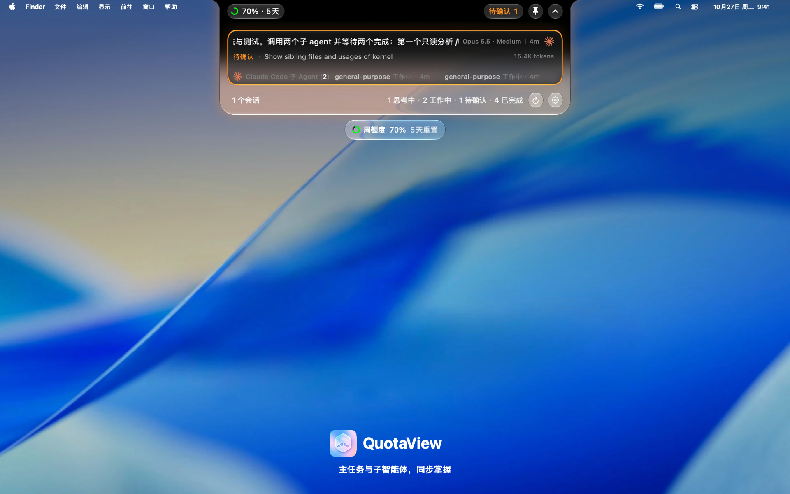</a></td>
  </tr>
</table>

### 过程与结果，按任务查看

有可用进度时展开查看步骤；任务完成后查看完成状态与结果详情。数据由原客户端提供，缺失或尚未同步的内容会保留提示。

<table>
  <tr>
    <th width="50%">任务进度</th>
    <th width="50%">DSH 结果详情</th>
  </tr>
  <tr>
    <td><a href="docs/media/readme/zh-CN/02-progress.jpg">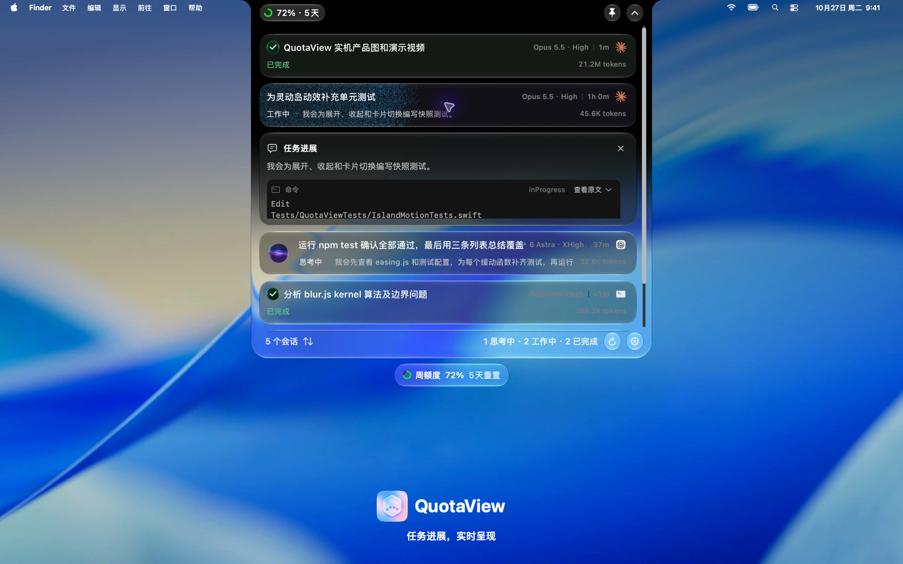</a></td>
    <td><a href="docs/media/readme/zh-CN/03-result-dsh.jpg">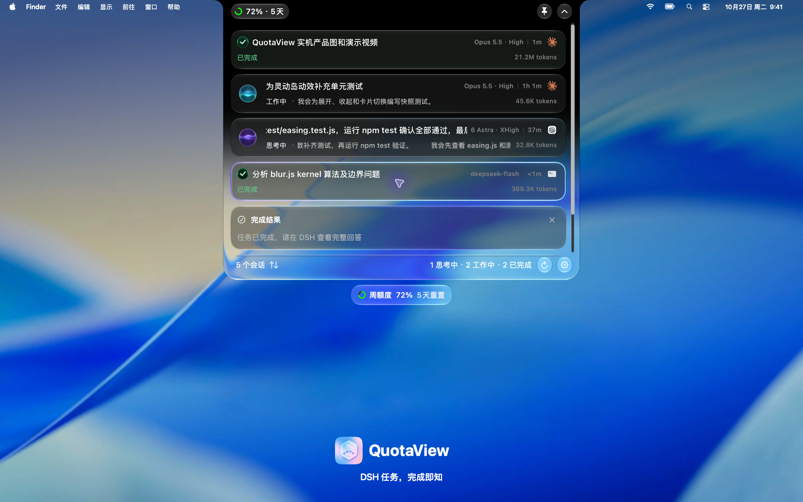</a></td>
  </tr>
</table>

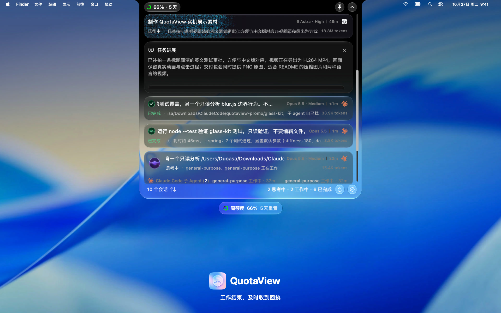

### 看清请求，再决定

需要审批时，先查看命令、工作目录、原因和授权范围，再选择允许或拒绝。支持的 Codex、Claude Code 请求可在灵动岛处理；DSH 与 Kimi Code 的权限请求回到原客户端确认。

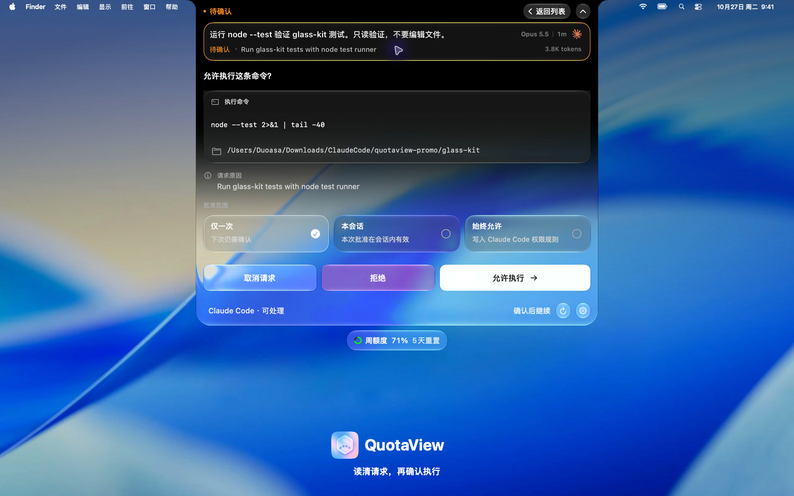

## 额度、Token 与活动，一页查看

切换 Codex 与 Claude Code，查看各自可获取的额度窗口、重置时间、Token 历史、成本估算与活动热图。悬浮胶囊根据账户支持的周期显示 5 小时额度、周额度或两者。

<table>
  <tr>
    <th width="50%">Codex 用量</th>
    <th width="50%">Claude Code 用量</th>
  </tr>
  <tr>
    <td><a href="docs/media/readme/zh-CN/04-usage-codex.jpg">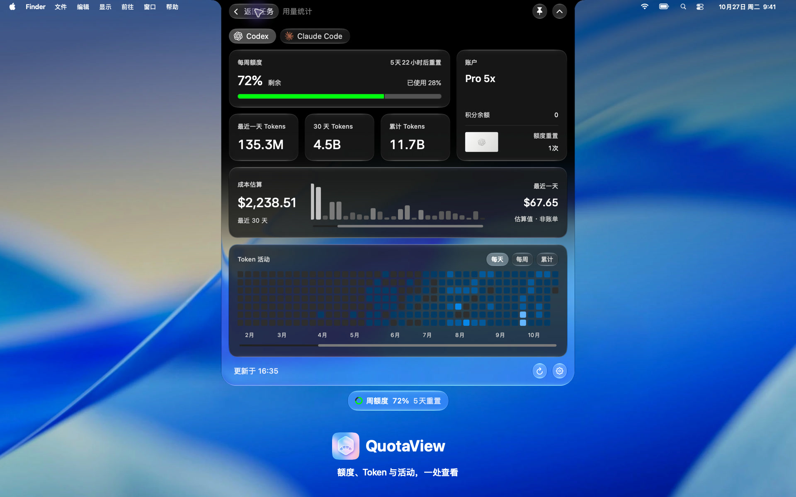</a></td>
    <td><a href="docs/media/readme/zh-CN/05-usage-claude.jpg">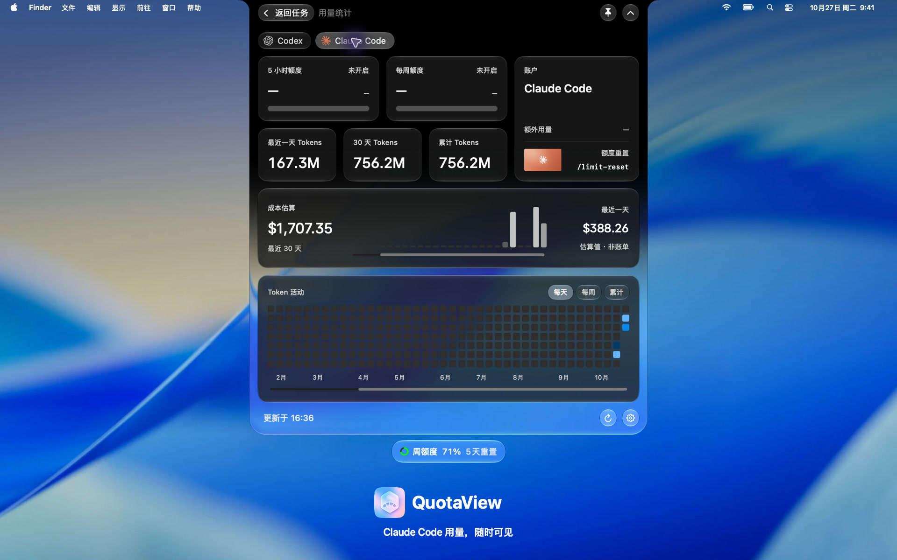</a></td>
  </tr>
</table>

额度字段取决于客户端和采集配置；没有数据时显示占位符。成本是估算值，不是账单。

### 重置之前，先确认

**Codex：**先检查可用重置卡，再由你明确确认使用。确认后会消耗 1 次真实重置机会；请求中断后，手动重试复用同一次操作和卡片，避免重复提交。

**Claude Code：**复制 `/limit-reset`，到 Claude Code 中执行并查看剩余次数与期限。QuotaView 不会替你执行 Claude 的重置。

<table>
  <tr>
    <th width="50%">Codex 手动重置</th>
    <th width="50%">Claude Code 原生命令</th>
  </tr>
  <tr>
    <td><a href="docs/media/readme/zh-CN/07-reset-codex.jpg">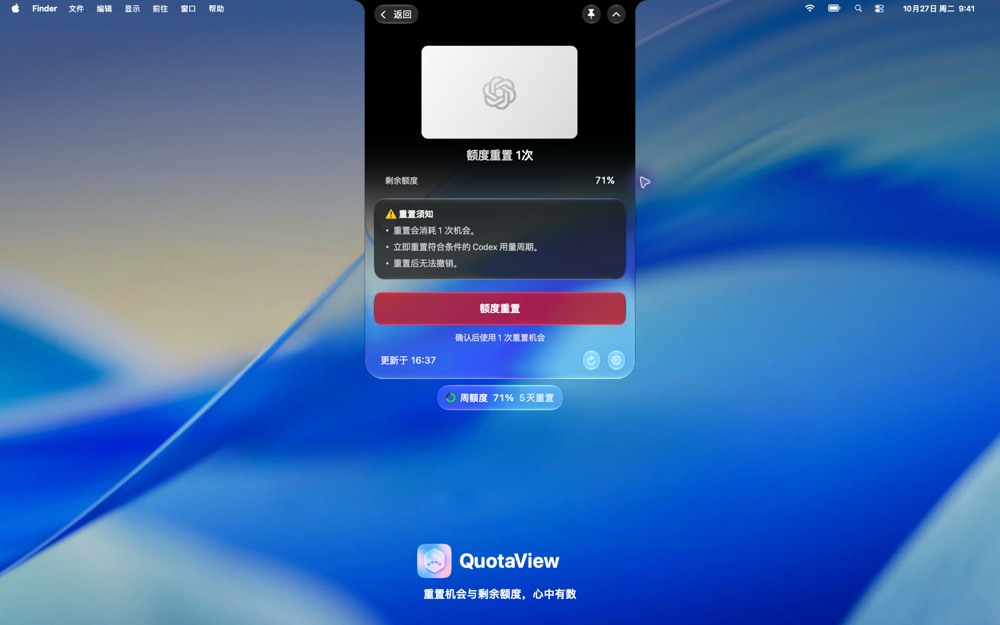</a></td>
    <td><a href="docs/media/readme/zh-CN/06-reset-claude.jpg">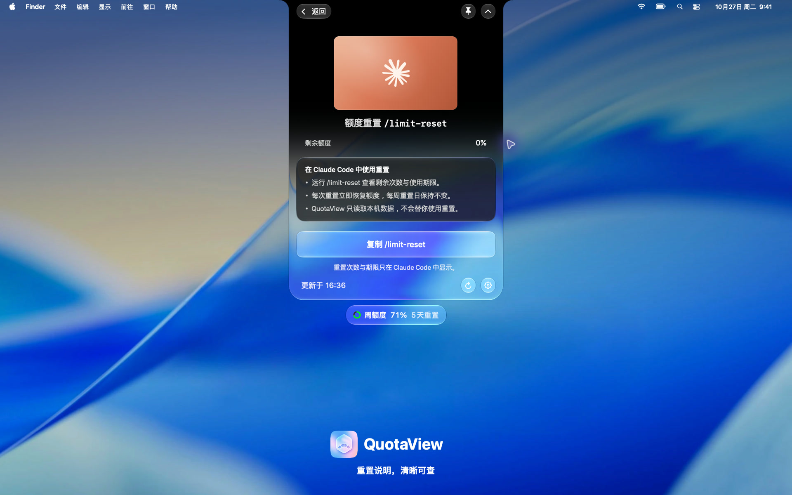</a></td>
  </tr>
</table>

## 按你的桌面来调整

选择液态玻璃或经典纯色；在液态玻璃下，浅色、深色和自动外观统一作用于底部玻璃、按钮与用量胶囊。任务特效紧邻预览，可切换状态烟雾、量子噪点与液态涌浪。

展开宽度、胶囊显示、隐私模式和自动展开可独立设置。多屏使用时，让灵动岛跟随活动窗口，或固定在指定显示器；在连接页统一管理各 Agent。

<table>
  <tr>
    <th width="50%">外观与任务特效</th>
    <th width="50%">Agent 连接</th>
  </tr>
  <tr>
    <td><a href="docs/media/readme/zh-CN/08-settings-island.jpg">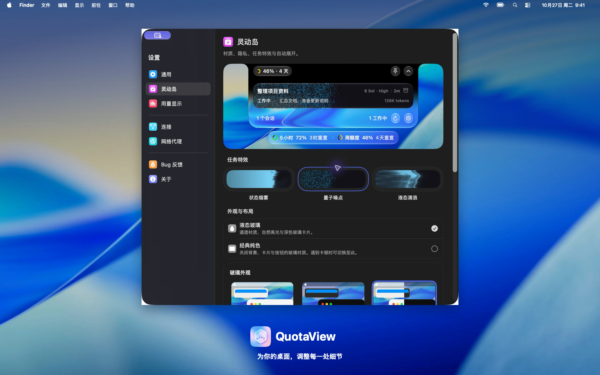</a></td>
    <td><a href="docs/media/readme/zh-CN/09-settings-connections.jpg">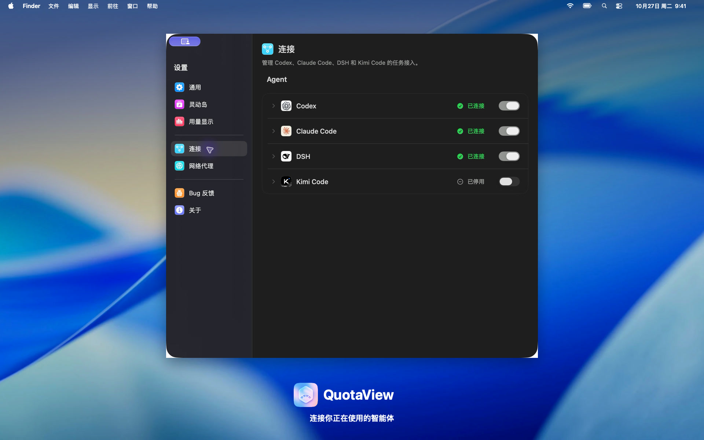</a></td>
  </tr>
</table>

原生液态玻璃需要 macOS 26 或更新系统；macOS 14–15 使用半透明材质，也可切换经典纯色。

## Agent 支持范围

| Agent | 任务与确认 | 用量 |
| --- | --- | --- |
| **Codex** | 自动发现本地任务，可选活动 Hook；支持的确认可在灵动岛处理。 | 可用账户额度、重置时间、Credits、Tokens、成本估算及手动额度重置。 |
| **Claude Code** | 启用 Hook 后显示任务状态及支持的权限请求。 | 本地 Token 历史与成本估算；开启状态栏采集后读取官方额度窗口。 |
| **DSH** | 原生插件接收会话、工具、压缩与权限提醒；兼容客户端统一显示为 DSH。 | 事件实际提供的任务 Token 数；不提供账户额度与历史成本面板。 |
| **Kimi Code** | Hook 接收任务状态、工具、压缩与权限提醒。 | 不提供账户额度与历史成本面板。 |

可用字段与操作取决于 Agent 及其版本。DSH、Kimi 接入由用户主动开启；详细边界见[接入规格](docs/specs/agent-integrations.md)。上表说明 macOS 版，Windows 支持范围见其安装说明。

## 快速开始

| 平台 | 当前版本与下载 | 系统与说明 |
| --- | --- | --- |
| **macOS** | [0.8.5 Build 1](https://github.com/Duoasa/QuotaView/releases/download/v0.8.5-build.1/QuotaView-v0.8.5-build.1.zip) | macOS 14+；Universal，支持 Apple 芯片与 Intel；Developer ID 签名与 Apple 公证。 |
| **Windows** | [0.8.3-win](https://github.com/Duoasa/QuotaView/releases/download/v0.8.3-win.10/QuotaView-Windows-0.8.3-win.10-x64.zip) | x64；[安装与接入说明](Windows/README.md)。 |

**macOS 安装：**

1. 下载并解压，打开 `QuotaView.app`。
2. 在**设置 → 连接**中启用需要的 Agent；Agent 客户端需先安装并配置。
3. Codex 自动发现本地任务。配置 Hook 或 DSH 插件后，按提示新建会话或重启对应客户端。

Windows 版已上线，是基于 macOS 版的功能降级适配，后续继续完善。当前包含纯色灵动岛、AI 球与量子噪点、任务及支持的审批、用量统计；不包含桌面小组件或原生液态玻璃。两平台在同一仓库维护，使用独立更新通道。Windows 包内版本与 tag 保留 `0.8.3-win.10`。

macOS 更新使用 Stable 通道，自动检查可选，安装更新需要确认。

### 0.8.5 更新

- 灵动岛接入 Codex 官方手动额度重置，确认后才提交，并保留重试所需的操作记录。
- 重置页统一深色玻璃，调整额度行对齐，补齐按钮与说明的深浅适配。
- 任务特效选项移至设置预览下方；继续包含 macOS 27 玻璃兼容、小组件显示修复与多屏设置。

[完整更新说明](https://github.com/Duoasa/QuotaView/releases/tag/v0.8.5-build.1) · [版本历史](VERSION_HISTORY.md)

## 隐私设计

任务信息在本地处理，不上传到 QuotaView 服务，也不收集登录凭据。接入使用本地接口、有界会话记录、Hook 或原生插件。

启用接入可能修改客户端配置；修改前保存备份，只管理 QuotaView 自己的标记项。DSH 定制客户端保持独立的数据目录与会话身份。Codex 重置会在本机保存操作记录用于安全重试，不保存登录凭据。反馈时请勿上传凭据或原始会话记录。

## 从源码构建

```bash
git clone https://github.com/Duoasa/QuotaView.git
cd QuotaView
swift test
swift run QuotaView
```

需要 Swift 6 或兼容的 Xcode 工具链；DSH 插件测试还需要 Node.js。完整 App 与小组件使用 `QuotaView.xcodeproj`，选择 **QuotaView** Scheme 和 **My Mac** 后运行。Windows 构建见 [Windows/README.md](Windows/README.md)。

分发包的签名、公证与更新密钥配置见[发布流程](docs/workflow/RELEASE.md)。

## 项目与反馈

- [提交问题](https://github.com/Duoasa/QuotaView/issues/new/choose)，也可从**设置 → Bug 反馈**进入。
- [贡献指南](CONTRIBUTING.md) · [设计与行为规格](docs/specs/README.md) · [开发交接](HANDOFF.md)
- 采用 [MIT 许可证](LICENSE)开源。

**QQ 反馈群：1108649282**

<p align="center">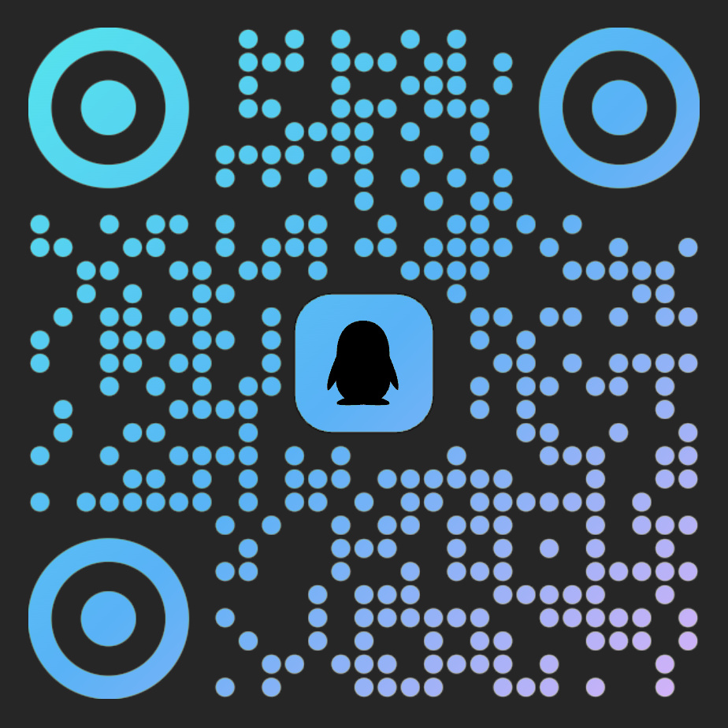</p>
