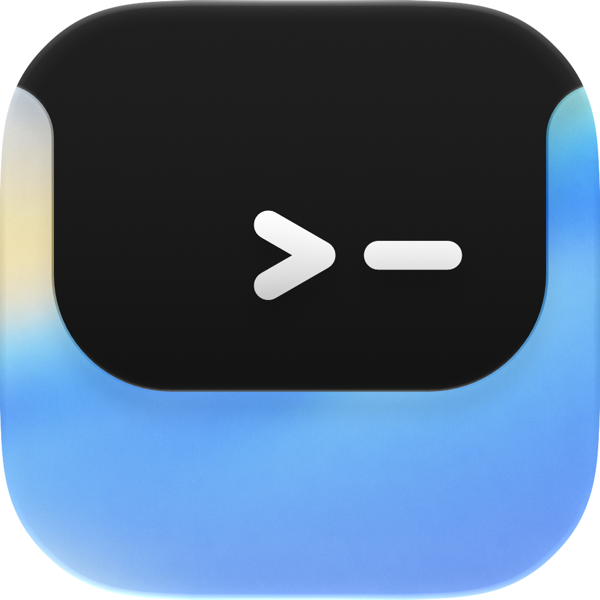
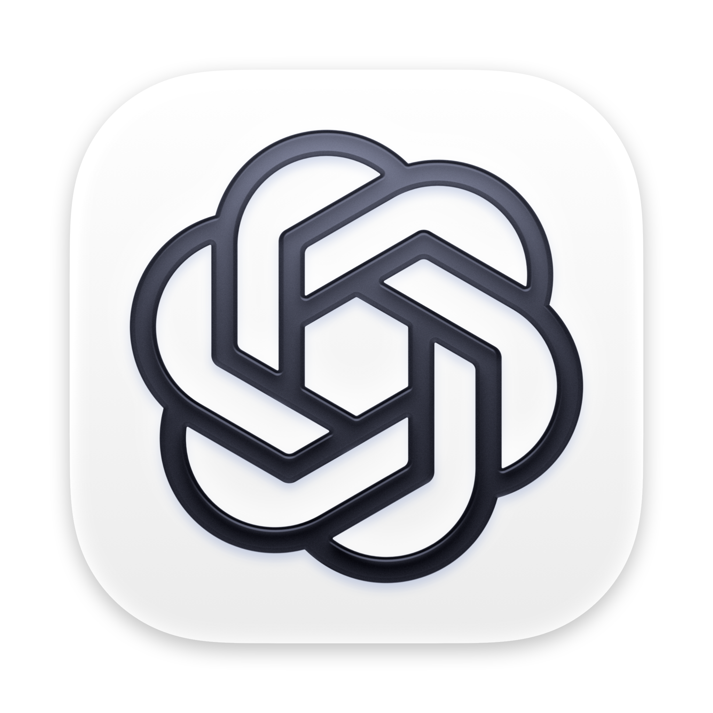
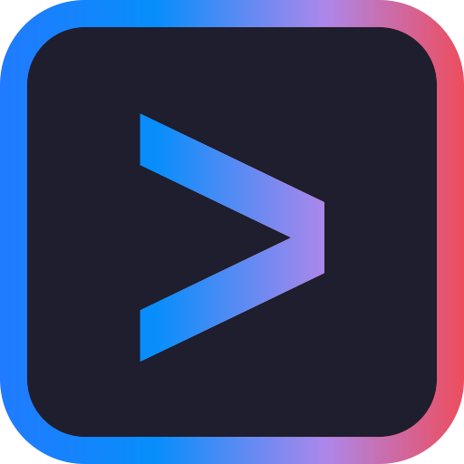
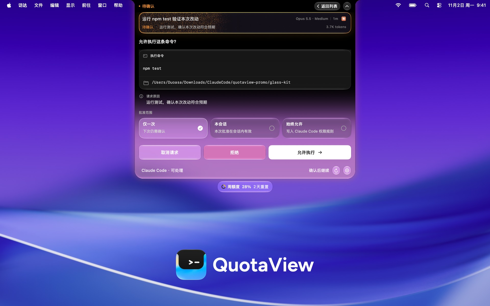
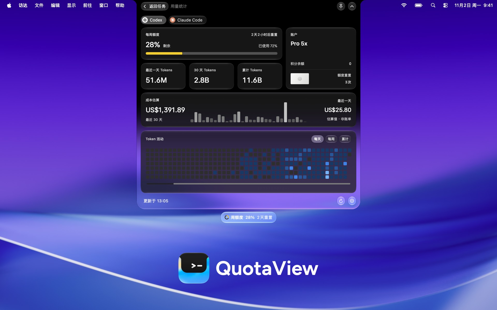
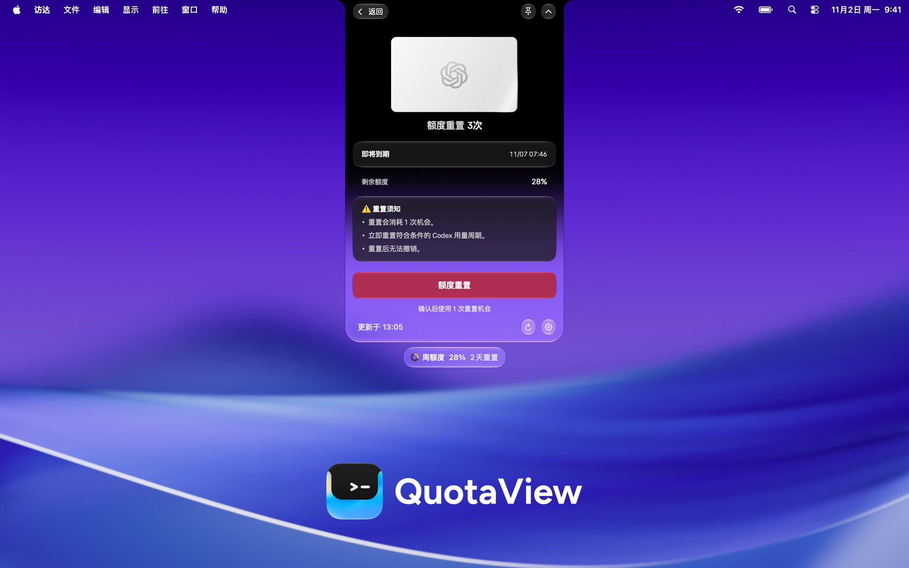
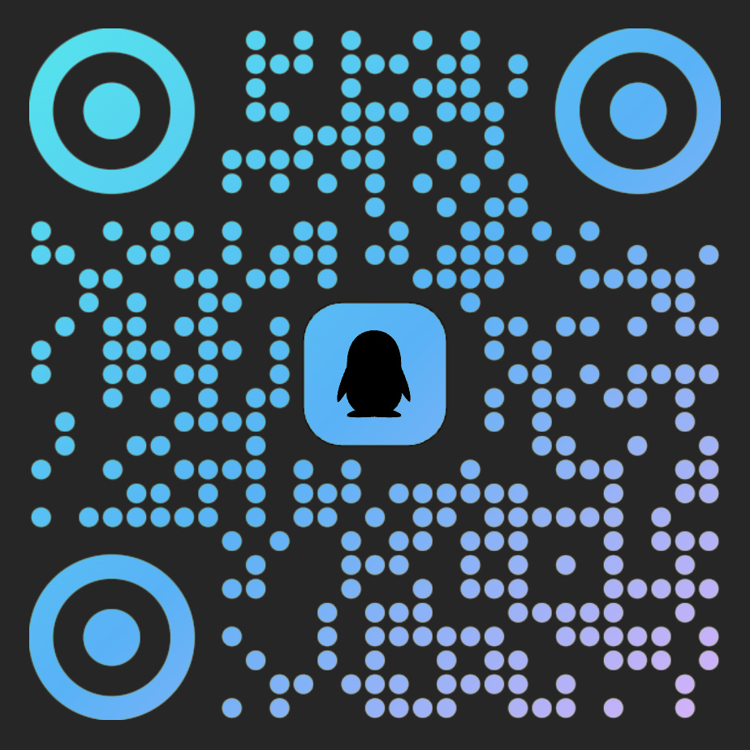

<h1 align="center">QuotaView</h1>

<strong>多 Agent 状态与用量灵动岛。</strong> 任务、审批与用量，都在桌面顶部。

   

<a href="https://github.com/Duoasa/QuotaView/releases/download/v0.9.3-build.1/QuotaView-v0.9.3-build.1.zip"><strong>下载 macOS 版</strong></a> · <a href="#highlights">Highlights</a> · <a href="#supported-agents">支持的 Agent</a> · <a href="#installation">安装</a> · <a href="#windows">Windows 备注</a>

<strong>简体中文</strong> · <a href="README.md">English</a>

QuotaView 把多个 AI Agent 的工作状态与用量集中在桌面顶部。谁在工作、谁需要确认、谁刚完成，抬眼就能看到；需要时展开灵动岛，查看任务详情、处理支持的请求，或了解剩余额度。

<h2>Highlights · 功能亮点</h2>

以下为 <strong>macOS 0.9.3</strong> 的完整功能概览。Windows 的版本与功能范围见<a href="#windows">单独备注</a>。

<table class="highlights">
<tr>
<td width="50%" valign="top">

<strong>👀 多 Agent，统一看状态</strong>

<ul>
<li>同时追踪多个本地会话，查看思考、执行、待确认、完成和失败状态。</li>
<li>在卡片中查看来源可提供的任务标题、模型、Token、耗时和当前工具。</li>
<li>展开任务详情、查看公开完成内容，以及有明确父子关系的子 Agent 活动。</li>
<li>支持卡片清理、悬停展开和固定展开，让当前工作留在眼前。</li>
</ul>
</td>
<td width="50%" valign="top">

<strong>✋ 审批与问题，就地处理</strong>

<ul>
<li>在确认之前查看命令、工作目录、原因和权限范围。</li>
<li>支持的 Codex、Claude Code、DSH 权限请求可直接在灵动岛允许或拒绝。</li>
<li>支持的 Codex 问题与 Claude Code 单选问题可在岛内回复。</li>
<li>不支持的请求或表单提示回到原客户端处理，保留原生确认流程。</li>
</ul>
</td>
</tr>
<tr>
<td width="50%" valign="top">

<strong>📊 额度、Token 与成本</strong>

<ul>
<li>切换 Codex 与 Claude Code，查看可用的 5 小时、每周额度及重置时间。</li>
<li>查看 Token 历史、按模型估算的成本和活动热图。</li>
<li>Codex 显示账户可提供的套餐与 Credits；Claude 官方额度可按需开启采集。</li>
<li>悬浮用量胶囊与 Small / Medium 桌面小组件，让用量随时可见。</li>
</ul>
</td>
<td width="50%" valign="top">

<strong>🎟️ 重置卡，到期前看得见</strong>

<ul>
<li>查看 Codex 可用重置卡，按到期时间列出未来一周内到期的卡片。</li>
<li>列表采用「即将到期 + 精简时间」；悬停可看完整日期与时区。</li>
<li>提供使用保护开关，每次重置均需确认；中断后可手动安全重试。</li>
<li>Claude Code 可复制 /limit-reset，回到原客户端执行重置。</li>
</ul>
</td>
</tr>
<tr>
<td width="50%" valign="top">

<strong>🎨 适配你的桌面</strong>

<ul>
<li>液态玻璃与经典纯色两种外观，实时预览状态烟雾、量子噪点和液态涌浪。</li>
<li>调整展开宽度、胶囊显示、隐私模式与自动展开；完成卡片采用中性底色。</li>
<li>多屏环境跟随活动窗口或鼠标所在屏幕，也可固定在指定显示器。</li>
<li>支持简体中文、繁體中文、English、日本語、한국어 和 Español。</li>
</ul>
</td>
<td width="50%" valign="top">

<strong>⚡ 本地处理，按需工作</strong>

<ul>
<li>统一管理 10 个 Agent 接入入口，各自启用、停用并查看连接状态。</li>
<li>任务信息在本机处理；通过本地接口、会话记录、Hook 或插件连接。</li>
<li>减少后台重复读取，Claude 转录后台解析，特效渲染器按需加载。</li>
<li>Developer ID 签名与 Apple 公证；默认自动检查更新，下载和安装由你确认。</li>
</ul>
</td>
</tr>
</table>

原生液态玻璃需要 macOS 26+；macOS 14–15 使用半透明材质。额度与元数据取决于来源，缺失数据保留未知；成本为估算值。

<h2>支持的 Agent</h2>

在「设置 → 连接」按需启用，各入口独立管理。

<table class="agents">
<tr>
<td align="center" width="20%" valign="top"> <strong>Codex</strong> </td>
<td align="center" width="20%" valign="top"> <strong>Claude Code</strong> </td>
<td align="center" width="20%" valign="top"> <strong>DSH</strong> </td>
<td align="center" width="20%" valign="top"> <strong>Kimi Code</strong> </td>
<td align="center" width="20%" valign="top"> <strong>Cursor</strong> 预览</td>
</tr>
<tr>
<td align="center" width="20%" valign="top"> <strong>Gemini CLI</strong> 预览</td>
<td align="center" width="20%" valign="top"> <strong>OpenCode</strong> 预览</td>
<td align="center" width="20%" valign="top"> <strong>GitHub Copilot CLI</strong> 预览</td>
<td align="center" width="20%" valign="top"> <strong>Devin Desktop</strong> 预览</td>
<td align="center" width="20%" valign="top"> <strong>Devin CLI</strong> 预览</td>
</tr>
</table>

<strong>审批与问题回复：</strong> Codex 与 Claude Code 的受支持请求可在灵动岛处理；其他入口在原客户端确认。Cursor 当前不提供权限提醒。

<strong>Devin：</strong> Desktop 与 CLI 分开展示。Desktop 仅接入本机 Devin Local；模型与本轮 Token 依赖兼容的本地记录，建议更新后开启新一轮任务。

<strong>兼容性：</strong> 预览接入仍在不同客户端环境中验证。OpenCode 当前覆盖 1.x；各入口不承诺相同的数据和交互能力。

<strong>查看各 Agent 的能力范围</strong>

<table>
<thead><tr><th>Agent</th><th>任务状态</th><th>审批与回复</th><th>模型与用量</th></tr></thead>
<tbody><tr><td>Codex</td><td>任务、工具与可用的父子任务</td><td>支持的审批与问题可在岛内处理</td><td>模型、Token、额度、Credits、历史与估算成本</td></tr>
<tr><td>Claude Code</td><td>任务、工具与完成内容</td><td>支持的审批与单选问题可在岛内处理</td><td>模型、Token、历史与估算成本；官方额度按需采集</td></tr>
<tr><td>DSH</td><td>原生插件事件、会话标题、最终回答与可用的子会话</td><td>支持的工具请求可在岛内审批，其余回 DSH 处理</td><td>事件提供的模型与 Token</td></tr>
<tr><td>Kimi Code</td><td>Hook 任务、工具与状态</td><td>权限提醒，原客户端确认</td><td>事件提供的模型；无账户额度面板</td></tr>
<tr><td>Cursor · 预览</td><td>本地 Hook 任务与工具状态</td><td>原客户端确认；不提供权限提醒</td><td>事件提供的模型；无账户额度面板</td></tr>
<tr><td>Gemini CLI · 预览</td><td>本地 Hook 任务与工具状态</td><td>权限提醒，原客户端确认</td><td>事件提供的模型；无账户额度面板</td></tr>
<tr><td>OpenCode · 预览</td><td>1.x 插件任务、工具与子会话</td><td>权限提醒，原客户端确认</td><td>事件提供的模型与标题；无账户额度面板</td></tr>
<tr><td>GitHub Copilot CLI · 预览</td><td>本地 Hook 任务与工具状态</td><td>权限提醒，原客户端确认</td><td>事件可提供的元数据；无账户额度面板</td></tr>
<tr><td>Devin Desktop · 预览</td><td>本机 Devin Local，独立开关</td><td>权限提醒，原客户端确认</td><td>兼容记录格式中的会话模型与本轮 Token</td></tr>
<tr><td>Devin CLI · 预览</td><td>本机 CLI 任务，独立开关</td><td>权限提醒，原客户端确认</td><td>兼容记录格式中的会话模型与本轮 Token</td></tr>
</tbody></table>

<a href="docs/specs/agent-integrations.md">接入说明与兼容范围</a>

<h2>功能一览</h2>

<strong>收起态：任务状态与悬浮用量胶囊</strong>

<strong>展开态：多个 Agent 的任务与详情</strong>

<strong>审批：看清请求，再决定</strong>

<strong>用量：额度、Token、成本与活动</strong>

<strong>重置卡：可用次数、使用保护与到期列表</strong>

<h2>安装与更新</h2>

<strong>macOS 14+</strong> · Apple silicon + Intel 通用包 · Developer ID 签名 · Apple 公证

<ol><li>下载 <a href="https://github.com/Duoasa/QuotaView/releases/download/v0.9.3-build.1/QuotaView-v0.9.3-build.1.zip">QuotaView 0.9.3 Build 1</a>，解压后打开 <code>QuotaView.app</code>。</li><li>进入「设置 → 连接」，启用已在本机安装和配置的 Agent。</li><li>Codex 可自动发现本地任务；配置 Hook 或插件后，按提示开启新会话或重启对应客户端。</li></ol>

<strong>默认开启自动检查更新</strong>，已有用户偏好保留，可随时在设置中关闭；下载与安装仍需确认。

<strong>0.9.3 本次更新</strong>

<ul>
<li>重置卡新增粒子消散与流畅递补，完善确认提示和空状态。</li>
<li>设置页退出按钮使用红色玻璃并固定右下角，优化留白与窗口最小高度。</li>
<li>刷子图标明确卡片清理含义，仅移除灵动岛卡片，保留原任务与聊天。</li>
<li>支持列表中的 Agent 图标统一圆角矩形底。</li>
</ul>

<a href="https://github.com/Duoasa/QuotaView/releases/tag/v0.9.3-build.1">完整发布说明</a> · <a href="VERSION_HISTORY.md">版本历史</a>

<h2>Windows · 单独说明</h2>

Windows 当前版本为 <strong>0.8.3-win.13</strong>，使用独立发布和更新通道。上方产品图与 Agent 支持列表描述 macOS 0.9.3。

<ul>
<li>提供纯色灵动岛、任务状态、兼容客户端的审批和问题回复、用量统计、AI 球与量子噪点。</li>
<li>功能按 Windows 能力适配；不包含 macOS 原生液态玻璃和桌面小组件，Agent 范围以 Windows 说明为准。</li>
<li>需要 Windows x64 和 WebView2 Evergreen Runtime。完整解压后运行 <code>QuotaView.Native.exe</code>，请保留整个应用目录。</li>
</ul>

<a href="https://github.com/Duoasa/QuotaView/releases/download/v0.8.3-win.13/QuotaView-Windows-0.8.3-win.13-x64.zip"><strong>下载 Windows 版</strong></a> · <a href="https://github.com/Duoasa/QuotaView/releases/tag/v0.8.3-win.13">Windows 发布说明</a> · <a href="Windows/README.md">安装与连接</a>

<h2>隐私与本地处理</h2>

任务信息在本机处理。QuotaView 不把任务内容发送到 QuotaView 服务，也不收集登录凭据。启用接入时会备份客户端配置，并仅管理自身条目；真实额度查询和重置仍通过对应服务处理。

Codex 重置仅保存用于安全重试的本地操作记录。反馈问题时，请勿附带凭据或原始会话日志。

<h2>从源码构建</h2>

<pre><code>git clone https://github.com/Duoasa/QuotaView.git
cd QuotaView
swift test
swift run QuotaView</code></pre>

需要 Swift 6 或兼容的 Xcode 工具链；DSH 插件测试还需要 Node.js。完整 App 与小组件使用 <code>QuotaView.xcodeproj</code>，选择 <strong>QuotaView</strong> Scheme 和 <strong>My Mac</strong> 后运行。

<a href="docs/workflow/RELEASE.md">发布流程</a> · <a href="Windows/README.md">Windows 构建</a>

<h2>项目与反馈</h2>

<a href="https://github.com/Duoasa/QuotaView/issues/new/choose">提交问题</a> · <a href="CONTRIBUTING.md">贡献指南</a> · <a href="docs/specs/README.md">设计与行为规格</a> · <a href="LICENSE">MIT License</a>

QQ 反馈群：<strong>1108649282</strong>

