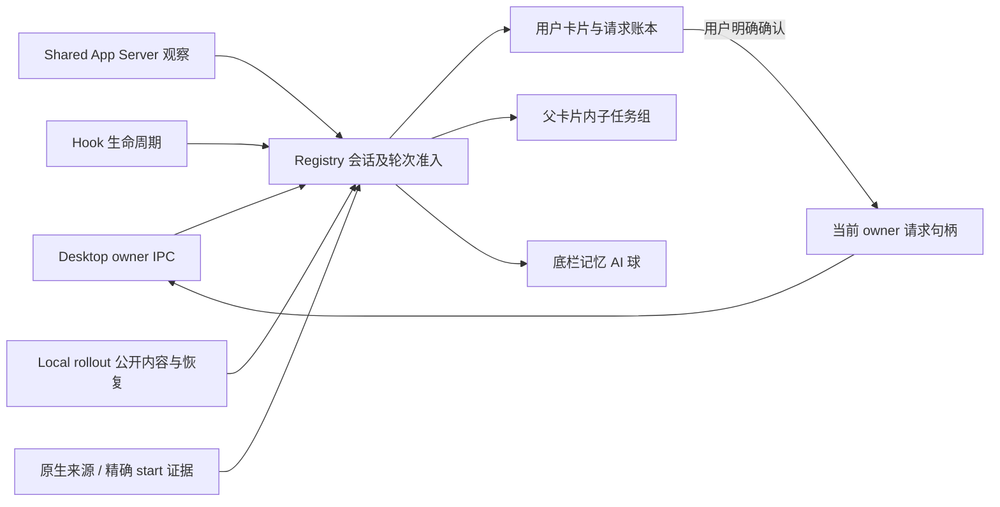

# Codex 与灵动岛的信息契约

Spec ID：`QV-PRODUCT-CODEX-ISLAND-INFORMATION-001` · `Accepted / Verifying` · 整理：2026-10-08。
身份、观察、应答和展示分别建立证据；当前运行及验证见 [Handoff](../../HANDOFF.md)。历史诊断与参考探针见[清理快照](../archive/maintenance-20261008/README.md)，临时路径不作为长期依据。

## 四种身份与两层作用域

| 身份 | 原生证据 | 展示 | 用户操作能力 |
|---|---|---|---|
| 用户会话 | 可靠 user 来源及已准入生命周期 | 普通卡片与用户统计 | 仅当前 owner、连接代次和请求句柄允许 |
| 用户派生子 agent | `parentThreadId` 或 `source.subAgent/subagent.thread_spawn.parent_thread_id`，父字段一致 | 对应父卡片的子任务组；自身状态/模型/时长 | 只读，不因父关系继承批准或问答能力 |
| 后台记忆 | 原生 `memory_consolidation` 来源，或当前执行 start 的同名 trigger | 独立底栏 AI 球；不进入列表或触发弹出 | 无 |
| 其他内部任务 | review/compact/guardian 等内部来源，或未能验证的泛 subagent 标识 | 不作为用户会话或用户子任务 | 无 |

线程来源是持久身份，执行目的只属于准确 `(sessionHash, turnHash)`。轮次记忆证明不能永久覆盖用户/子 agent 来源，来源更新也不能撤销当前记忆执行。标题 `memories`、`memories_v2`、目录名、模型缺失及工具参数均不提供分类权。后台任务的真实完成、失败、中断和断线分别保留。

Hook 的 `session_id` 是通道观察身份，不能直接等同原生 thread ID。只有一个原生记忆线程具有该准确 turn 证明时，Hook 执行可绑定其原生 `(sessionHash, turnHash)`；多个线程冲突时拒绝改写，非 Hook 通道不借用这种绑定。该绑定只作用当前执行，宿主别名的来源、父执行和其他轮次保持独立。来源无法确定的 unknown 不进入普通用户投影或统计。

## 通道各司其职

- Desktop IPC 跟随当前拥有者的会话快照、请求和响应能力；回传必须匹配 conversation、turn、request、owner、epoch。选中选项及编辑输入仅改草稿，点击确认才提交。断线、owner 切换、轮次结束立即撤销旧能力。
- Shared App Server、Hook、Local rollout 提供观察证据与恢复。独立 App Server 可读用量，但不能由“连接成功”推断它拥有 Desktop 任务或有权回复。
- 原生 start 读取是身份补充，不是生命周期来源；读到某个记忆标记不能伪造任务开始或完成。子任务关系也不能虚构仍在执行的历史子 agent。
- 公共助手正文和工具状态可用于进展；私有 reasoning、`agent_message` / inter-agent 私信、加密内容不进入展示。公开进展独立保存，工具结束不能把它一并清空。

应答链路分别记录“用户确认”“当前 owner 接受回传”“真实请求结算”“Codex 前端关闭”，不能用前一阶段推断后一阶段。同步问题使用 `thread-follower-submit-user-input`，原生异步问题使用 `thread-follower-steer-turn`；回传成功均不证明原生提问组已关闭。不得再发送一次相同答案，也不能以整组 Dismiss/Skip 清理可能包含其它草稿的问题。原生精确组关闭仍未完成，边界与隔离合同见[原生提问关闭规格](../design/codex-native-question-closure-contract-2026-10-03.md)。本次等待修复和本地退场不扩大此能力。

## 观察等待与本地提醒退场

- Hook 历史/执行 floor 有界，按真实来源和当前轮次准入；PermissionRequest 缺省 waitReason 为 approval，已知提问工具优先 userInput。普通活动不默认审批，也不推断 macOS 系统权限。
- 请求阻塞、匿名观察和 runtime 等待独立维护。当前同 owner/epoch 完整 pending 集合可结算已绑定的观察副本；部分/未知状态、旧代次或断线不是“已处理”证据。
- 工具开始/结果仅撤回匹配的弱观察；真实 RPC 必须由精确 native 结算或完整同作用域 owner 账本解除。Shared 与 Desktop 等待不互相清除。
- 完整原生 pending 移除后，显示可短暂衔接“同步中 · 请求已处理”（最多 2 秒）；明确 running 且无 pending 后旧观察保持退场。新请求/新等待优先，展示退场不代替底层真实结算。
- 弱提醒允许在 Island 本地隐藏，不发送响应或 resolved；每轮 notice fingerprint 与弱退场各有界 256 项，不能据此拒绝后来出现的真实 RPC。

### 原生异步问题的本地展示期限

| 阶段 | Island 行为 | 边界 |
|---|---|---|
| 未接管、未回答 | 首次有效显示起 30 秒退场 | 重复快照不续时，只隐藏此问题 |
| 已接管 | 实际草稿变更后保留问题 | 聚焦/hover 不算接管 |
| submitting | 不自动退场 | 不重发、不切换路由 |
| sent / resultUnknown | 进入阶段后 3 秒本地交回 Codex | 不标已回答，不补发 |
| 精确原生回答/真实终态 | 清理对应问题 | 不清并行请求 |

退场账本按 thread、turn、原生 questionItemId 的哈希持久记录，最多 4096 项；不存题目/草稿/答案。重复快照、重连和重启不重新接管账本内同作用域问题；有界账本不保证无限历史去重。同步 RPC、未知 pending 及非问题等待不使用此计时器。
原生 minimize 精确同步与问题组关闭仍未实现/验证，本地期限不扩大应答能力。

## IPC 投影与大状态

生产完整帧/单会话/总状态预算为 72/64/128 MiB；详细 drain、身份和恢复边界由 [Desktop 同步规格](codex-desktop-confirmation-sync.md#失败资源与恢复)维护。
投影直接复用重建 JSON 树；初始快照计算预算，patch 只记变化子树及键/分隔开销。禁止每个 patch 全历史编码/解码阻塞 reader，也不能以优化为由截断 pending 或跳过请求事件。完整 Data 仅按需兼容读取。

## 同步、预算与恢复

每个所选 Codex 数据目录和 native generation 共用一个 `CodexLocalExecutionMetadata.Service`；Hook classifier 和 Local 刷新不再各自创建互不一致的读取缓存。服务按线程的最新 start 记录确定当前执行；单个超限、失败或未覆盖线程不清除其他已验证身份。`ReadResult` 区分完整、部分和失败，并显式返回已覆盖/失败 session 集合。

保留原有 24 小时、50 ms、64 KiB 单条、2 MiB 总读取限制。薄索引发现按最新头部与 keyset 历史游标推进，hash→原始线程映射及偏好列表有界；已准入的当前轮次优先查询并轮换，避免一个高活动线程占满记录窗口。已覆盖线程的最新非记忆 start 可撤销该线程旧证明，部分读取不能撤销未覆盖证据。

Store 接到早于生命周期的精确记忆身份时，保存有界 pending evidence。只有同 generation、准确原生 session/turn 的真实事件准入才能消费；Hook 原生身份绑定必须先通过上方唯一 turn 规则。不同轮次、旧代次、停止和淘汰不会污染当前任务。分类缓存读取时限也按 session+turn 判断，新轮次不受上一轮读取节流阻挡。

身份晚于 Hook 生命周期时，使用当前目录/generation 内有界128份真实 Hook 观测迁移同 turn 的开始与终态；来源元数据不能生成新的生命周期。单独结束证据不能建立执行，终态先到不被晚到开始复活，SessionEnd 仍清理执行。撤回只作用旧 Hook 别名下同 turn 的普通卡片、选择和对应展示；若别名已承载父会话新轮次，不能撤销父执行或清空其显示元数据/可靠来源。已绑定观测不再次由元数据回放旧开始；只有Registry真正接受的结算建立终态墓碑。被更强来源拒绝的Hook stop不成为墓碑，仍活跃的逐出执行可由新真实正向事件重新准入。重复事件与迟到元数据不能恢复已逐出的旧执行。记忆进入既有后台球，不回答或归档 Codex 任务。

子任务先保留权威关系，再以真实 Registry 准入事件建立运行状态。迟到关系只重放已准入的真实事件；来源失效时显示状态待更新，终态不被旧事件复活。关系、显示 title、公开内容和自己的模型分别传递，随机 nickname 不覆盖真实 title。事件、内容、任务统计和请求账本不互相冒充。

执行 Registry 的 128 个槽位与持久来源的 1024 项 LRU 是不同预算。执行逐出会立即撤销对应子任务的运行投影，同时有界保留来源/父子关系；后续真实正向事件才可重新准入，单独元数据或结束事件不能恢复执行。来源 LRU 逐出也撤回关系与运行投影。Shared 每条子任务观察投影附带本连接已验证的原生父关系，避免稀疏消息在 Store 缓存缺失时退成用户来源。停止或目录更换撤销整代观察。

诊断只记录 hash 前缀、轮次 hash、generation、pending/applied/rejected，以及读取状态和覆盖数量；不记录提示正文、答案、私信或原始线程 ID。这样下一次异常可区分“没读到”“读到未匹配”“已匹配但展示错误”。

### 长会话恢复与显示元数据

2026-10-04 当前会话的只读记录证实：rollout 已超过 280 MiB，末尾 16 MiB 内无本轮 `task_started`，但真实 `turn_context` 与用量记录仍存在。恢复不得因此丢弃独立线程显示元数据，也不扩大读取预算或全量扫描文件。

原生数据库的明确 `name` 优先于旧 `title` 和目录名占位；模型、思考等级和累计线程 Token 独立补齐已有卡片，空值不清空有效信息。占位标题不能阻止迟到真实标题，也不能覆盖已有高可信标题。仅元数据不创建任务、不改变轮次或执行状态、不赋予问题/批准权限；无卡片时只作有界缓存，真实生命周期准入后才应用。

尾部 `turn_context.turn_id` 仅能匹配当前 Registry 已准入执行的 `(sessionHash, turnHash)` 后恢复本轮 decoder。若真实生命周期晚于首次 bootstrap，允许固定预算重扫一次；历史轮次、旧代次及已结束执行不得借此复活。恢复的 Token 必须继续满足线程/轮次及累计关系校验；历史待确认状态和问题不随补读重放。最近同轮公开助手消息在原200条/2MiB内容预算内保留；工具洪流不能挤掉它，换轮撤销保护。历史tool/output只恢复公开条目，不改变working/thinking、不清当前工具或结算请求。首次Hook观测时间不是本轮真实起点，因此精确同轮累计展示可接受更早记录并取单调最大值，Store本轮账本保持独立。

## 展示、完成内容与验收

当前卡片、记忆底栏、完成保留、纯色描边和待机比例统一见[生产交互](../design/quotaview-island-production-interaction-review-2026-09-30.md)与[界面规范](../design/QUOTAVIEW_UI_RULES.md)，不在通信契约重复视觉参数。

完成正文使用公开最终回答。TextKit 显示栈须持有真实存储/排版器/容器；缓存测量通过不代表显示正文存在。链接由用户点击打开，文件路径交 Finder 定位，不执行链接脚本。
有界摘要、重复刷新抑制与动画时钟规则见[效果契约](PROGRESS_EFFECT_ADAPTATION.md#8-2026-10-05-刷新与动画连续性修订)。

原生来源、独立生命周期、真实交互与视觉验收分别记录。过去 124 项记忆冒烟、101 项长会话检查等只属于其阶段，不作为本次整包复验。当前未完成项见 [Handoff](../../HANDOFF.md#未完成项)。
